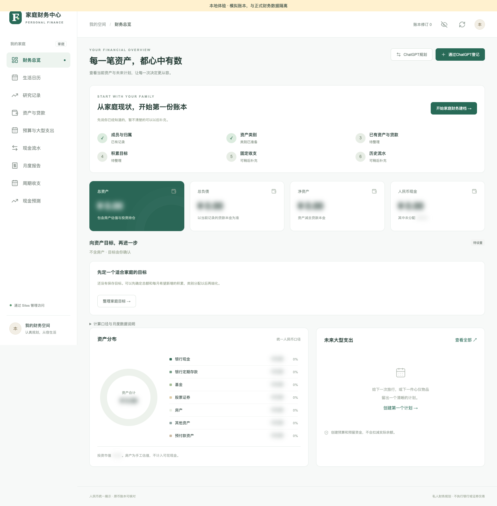

# Family Finance Center

[中文](README.md) · **English**

Organize household finances with ChatGPT, then review records, approve budgets together, and track your ledger on the website. Features cover assets, loans, budgets, actual cashflow, a calendar, recurring items, and monthly reports.

[Quick start](docs/USER-GUIDE.en.md) · [Documentation](docs/README.en.md) · [Development](docs/DEVELOPMENT.en.md) · [Data security](SECURITY.en.md)

[Full product manual](docs/PRODUCT-MANUAL.en.md) · [40 key cases](docs/KEY-CASES.en.md) · [Standalone bilingual illustrated edition](docs/product-demo.html)

The HTML embeds18 demo images for offline language switching, case search, and printing. Read the Markdown editions directly on GitHub.



*Screenshots use isolated demo households. See [provenance](docs/assets/workflows/README.md) for dates and limitations.*

## Workflow

1. Connect your own Family Finance Center in ChatGPT and read its workflows and authorized household context.
2. Organize onboarding, spending, investment, or image tasks and save drafts when ready.
3. Review amounts, accounts, dates, sources, and balance coverage under **研究记录 / Research records** on the website.
4. Budgets enter the formal budget and calendar after every active signed-in household member agrees.
5. Record actual receipts or payments only after they occur. Approval, scheduling, and research do not execute payments or trades.

The app does not operate bank or brokerage accounts. Public source code is separate from a deployment's private ledger; repository access does not grant financial access.

## Features

| Area | Purpose |
| --- | --- |
| Overview, current assets | Assets, liabilities, ownership, custom types, goals, restricted pension accounts |
| Research records | Review seven draft types and browse research and processing history |
| Budget plans and calendar | Household approval, itineraries, execution, actual expenses, investment follow-ups |
| Cashflow | Actual income and expenses, image candidates, budget links, prepayment settlement |
| Recurring items, forecasts, monthly reports | Separate actual and forecast values; inspect journal summaries and archives |
| Account menu | Household management, goals, memberships, workflow integration |

There are seven business workflow entry points and thirteen financial MCP tools. An additional connection check has a [local implementation record, Chinese](docs/VERIFICATION-PLUGIN-INSTALLATION-2026-11-13.md); deployed tool counts depend on the connected session. See the [Chinese MCP reference](docs/CHATGPT-MCP-SKILLS.md). For everyday use and Codex installation, start from **工作流集成 / Workflow integration** in your own signed-in site. This repository does not itself provide a published one-click plugin.

## Local development

Node.js 24 is recommended; the declared minimum is 22.13.0. Install from the lockfile:

```sh
npm ci
npm test
npm run typecheck
npm run dev:local
```

The preview defaults to `http://127.0.0.1:5173`, with simulated identities and separate SQLite storage. It is for local use only. See [development instructions](docs/DEVELOPMENT.en.md) for browser checks, builds, and deployment boundaries.

## Documentation and security status

As of 2026-11-16, controlled release v63 is deployed and eight confirmed issues were fixed and independently retested by the relevant reviewers. The current account can read its private plugin workflows. Public submission is blocked on developer identity, organization payment and card-issuance eligibility; other real ChatGPT accounts and physical iPad acceptance remain open. See [publication and household access](docs/PUBLIC-PLUGIN-RELEASE-2026-11-16.en.md) and the [Chinese acceptance record](docs/RELEASE-ACCEPTANCE-2026-11-16.md). A GitHub push does not publish a plugin or expand private-ledger access.

The product top bar and household join page offer Chinese / English switching for navigation, forms, system statuses, notices and validation errors. Preferences are saved locally; account names, notes and historical analysis retain their original text. See [product localization and key cases](docs/UI-I18N.en.md). Public user documentation is also bilingual. Display currency defaults to USD in English and CNY in Chinese, with a manual override. Summaries use a valid reference exchange rate while ledger records and input forms retain their actual currencies.

Personal parameters, screenshot transcriptions, and deployment receipts have been removed from public documents. Older Git commits still contain private prose; history cleanup is outstanding. This review does not certify GitHub's remote branches or production security. See the [current review](docs/PUBLIC-DATA-REVIEW-2026-11-13.md).

Historical requirements and checks are not current instructions or newly executed evidence. Third-party license notices remain alongside their files. No project-level open-source license has been added.
