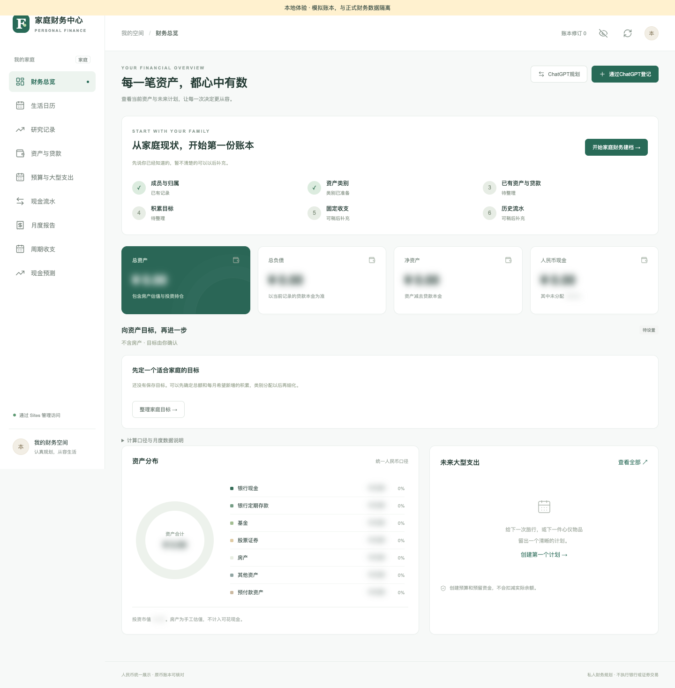

# 家庭财务中心

**中文** · [English](README.en.md)

用 ChatGPT 整理家庭财务，在网站逐项核对、共同审批并查看账本。覆盖资产与贷款、预算、实际收支、生活日历、周期收支和月度报告。

[快速上手](docs/USER-GUIDE.md) · [文档导航](docs/README.md) · [开发与验证](docs/DEVELOPMENT.md) · [数据安全](SECURITY.md)

[完整产品操作手册](docs/PRODUCT-MANUAL.md) · [关键案例库（40项）](docs/KEY-CASES.md) · [单文件中英文图文演示](docs/product-demo.html)

图文版内嵌18张演示截图，下载后可离线切换语言、搜索案例和打印；GitHub在线阅读使用Markdown手册。



*截图来自隔离演示账本。来源、日期与适用范围见[截图说明](docs/assets/workflows/README.md)。*

## 如何协作

1. 在 ChatGPT 连接自己的家庭财务中心，读取工作流和授权家庭数据。
2. 整理建档、消费、投资或图片任务，确认后保存为待核对草稿。
3. 回网站“研究记录”核对金额、账户、日期、来源及余额覆盖情况。
4. 预算经全体有效登录成员同意后进入正式预算与生活日历。
5. 实际发生收付款后再核对记账。审批、排期和研究均不自动扣款或交易。

网站不操作银行或券商。公开源码与部署中的私人账本分开；拥有仓库链接不授予家庭财务访问权限。

## 功能入口

| 入口 | 用途 |
| --- | --- |
| 财务总览、资产现状 | 资产负债、成员归属、自定义类别、目标与受限养老金账户 |
| 研究记录 | 集中核对七类草稿，查阅研究与处理历史 |
| 预算计划、生活日历 | 家庭审批、行程、执行、实际消费与投资复核 |
| 现金流水 | 实际收支、图片候选、预算关联与预付款冲抵 |
| 周期收支、现金预测、月度报告 | 区分已发生与预计，查看分录汇总及历史归档 |
| 账户菜单 | 家庭管理、目标、会员权益与工作流集成 |

当前有七个业务工作流入口、十三个财务 MCP 工具；新增连接检查工具已有[本地实现记录](docs/VERIFICATION-PLUGIN-INSTALLATION-2026-11-13.md)，部署数量以当前会话发现为准。财务契约见[接口说明](docs/CHATGPT-MCP-SKILLS.md)。普通使用和 Codex 安装从自己已登录站点的“工作流集成”开始。GitHub 仓库本身不提供已发布的“一键安装插件”。

## 本地开发

建议 Node.js 24；项目声明最低版本为 22.13.0。使用锁文件安装：

```sh
npm ci
npm test
npm run typecheck
npm run dev:local
```

预览默认地址为 `http://127.0.0.1:5173`，使用模拟身份与独立 SQLite，只用于本机。浏览器检查、构建和部署边界见[开发说明](docs/DEVELOPMENT.md)。

## 文档与安全状态

截至2026-11-16，受控站点v63已发布，8项确认问题已修复并经对应角色独立复测；当前账户可读取私有插件工作流。公共上架受开发者身份、组织付款及发卡地区资格阻断，家人独立ChatGPT连接与物理iPad仍待验收。详见[发布与家庭使用状态](docs/PUBLIC-PLUGIN-RELEASE-2026-11-16.md)和[验收记录](docs/RELEASE-ACCEPTANCE-2026-11-16.md)。GitHub推送不等于公开插件，不扩大私人账本访问。

产品顶栏及加入家庭页支持中文 / English 切换，导航、表单、系统状态、提示及校验错误随语言切换；本机保存语言偏好，账户名称、备注和历史分析保留原文。详见[产品界面国际化与关键案例](docs/UI-I18N.md)。公开使用文档也提供中英文版本。 展示币种默认随语言切换：英文 USD、中文 CNY；也可手动固定。汇总按有效参考汇率折算，账本和记账表单保持原币。

公开文档已删减个人参数、截图转录和部署回执。旧 Git 提交仍含历史私人文字，历史处理尚未完成；本次不能证明 GitHub 远端、所有分支或生产环境无敏感数据。详见[本轮安全校验](docs/PUBLIC-DATA-REVIEW-2026-11-13.md)。

旧需求与验收记录用于追溯，不能代替当前指南或新验收结果。第三方许可证保留在对应目录；本仓库尚未提供项目级开源许可证。
