# Product operation and demonstration manual

[中文](PRODUCT-MANUAL.md) · [English](PRODUCT-MANUAL.en.md) · [单文件图文演示 / Offline illustrated edition](product-demo.html) · [Key case library](KEY-CASES.en.md)

Complete instructions for household administrators, members, and demonstrators, organized around product entry points rather than engineering requirements. Eighteen chapters cover all thirteen navigation/account-menu entries in the current source; forty cases are maintained separately.

Baseline: local worktree on2026-11-13, including unpublished plugin changes; production may differ. Published images are reviewed historical isolated demos/components, not a newly captured continuous production flow. Older goal/pension/membership samples with personal-input provenance are excluded; gaps are explicit.

Demonstrate only with independent synthetic household data. D is the demo date and D-1 the previous day. Amounts are major currency units, entered as strings; backend minor units are not yuan/dollars. Real-world completion is required for actual accounting; never create fictitious transactions in a real ledger.

## Entry-point coverage

| Entry | Chapters |
| --- | --- |
| Overview | [M04](#m04) |
| Calendar | [M12](#m12) |
| Research records | [M13](#m13) |
| Assets and loans | [M05](#m05) / [M07](#m07) / [M08](#m08) / [M09](#m09) |
| Budgets and major expenses | [M10](#m10) / [M11](#m11) / [M15](#m15) |
| Cashflow | [M11](#m11) |
| Monthly reports | [M16](#m16) |
| Recurring cashflow | [M14](#m14) |
| Cash forecast | [M15](#m15) |
| Memberships | [M17](#m17) |
| Household management | [M01](#m01) / [M03](#m03) |
| Workflow integration | [M02](#m02) |
| Goals | [M06](#m06) |

## Contents

- [M01 Sign-in, household invitations, and permissions](#m01)
- [M02 Connect ChatGPT and check the current session](#m02)
- [M03 Onboard an empty household](#m03)
- [M04 Read the overview, privacy mode, and member filters](#m04)
- [M05 Asset types, bank accounts, transfers, and archiving](#m05)
- [M06 Configure asset goal combinations](#m06)
- [M07 Record securities purchases, additions, partial sales, and liquidation](#m07)
- [M08 Loan details, simulation, future budgets, and actual repayment](#m08)
- [M09 Pension funding, internal investment, redemption, and classification](#m09)
- [M10 Spending plans, cost review, and individual approval](#m10)
- [M11 Payments, prepayments, settlement, refunds, and cashflow](#m11)
- [M12 Calendar, multi-day plans, investment follow-ups, and cancellation](#m12)
- [M13 Research records, same-ID updates, and processed history](#m13)
- [M14 Recurring rules, due-item confirmation, and history analysis](#m14)
- [M15 Cash forecasts, annual budgets, and funding gaps](#m15)
- [M16 Monthly reports, immutable archives, and ChatGPT review](#m16)
- [M17 Membership validity and incremental trip costs](#m17)
- [M18 Attachments, retries, sign-out, and common recovery](#m18)

## Demonstration spine: plan to actual consumption

Open a synthetic bank balance1,000 with C01, demonstrate a300 budget and separate member approval with C04/C05, follow C09 for settlement, then compare monthly archives with C27. These are expected accounting checkpoints, not newly passed manual receipts.

| Step | Bank cash | Prepaid asset | Check |
| --- | ---: | ---: | --- |
| Opening and budget approval | 1000 | 0 | Budget300 does not debit |
| Actual payment120 | 880 | 0 | Correct plan/member/account |
| Prepay50 | 830 | 50 | Prepaid is not consumption |
| Consume30 prepaid | 830 | 20 | No second cash debit |
| Receive unused20 refund | 850 | 0 | Original account; consumption total150 |

## M01 Sign-in, household invitations, and permissions

**Entry：** Site sign-in → avatar → 家庭管理 (Household management)

**Before starting：** Use two independent demo identities; never publish real invitation links or other households’ data.

### Steps

1. Sign in with your own ChatGPT account; verify the invitation source if not yet a member.
2. The administrator opens Household management, confirms the household name, and chooses 生成邀请链接 (Generate invitation). Send it privately to the intended person.
3. The recipient signs in separately, checks the household name, and chooses 确认加入家庭 (Join household).
4. Check administrator/read-only roles. Add bookkeeping nicknames under 家庭记账成员 and optionally link existing signed-in members.
5. For removal, transfer, or leaving, select the corresponding member action and read the confirmation before submitting.

**Expected result：** Members can read their own household. Ordinary members cannot make general financial changes but can submit their own budget opinions. Nicknames grant no access; management transfer does not change historical asset ownership.

**Checks and exceptions：** Invitations are single-use, expire after seven days, and can be revoked. A leaked active link may let its holder join. Administrators must transfer management before leaving. Screenshot gap: no publishable complete invitation/real-second-user sequence is available.

**Related cases：** [C13](KEY-CASES.en.md#c13) / [C14](KEY-CASES.en.md#c14) / [C15](KEY-CASES.en.md#c15) / [C16](KEY-CASES.en.md#c16) / [C17](KEY-CASES.en.md#c17)

> No reviewed publishable dedicated image is available; see the limitations.

## M02 Connect ChatGPT and check the current session

**Entry：** Avatar → 工作流集成 (Workflow integration); connected apps in ChatGPT

**Before starting：** Verify website identity and the ChatGPT connection separately; plugin registration/distribution still has external dependencies.

### Steps

1. Open Workflow integration and read the connection instructions. If no real installation entry is available, the maintainer must complete distribution; do not invent a plugin URL.
2. Choose 检查本站连接 (Check this site), then inspect the account, household, role, and workflow availability.
3. In a new connected ChatGPT conversation, ask “Check my Family Finance Center connection” to verify that conversation separately.
4. Once connected, ask it to read existing data before planning. For a task prepared on the site, ask it to continue the prepared task.
5. On phones/iPads use an actually available connected conversation. The legacy desktop skill installer is only for Codex environments with MCP already configured.

**Expected result：** The site check does not expose balances/transactions or change the ledger. A website success cannot certify another conversation’s installation. There are seven business entry points, with a separate connection-check capability.

**Checks and exceptions：** S09 shows a local addition, not proof of deployment, directory publication, or real iPad installation. After a 401, sign in and check again rather than trusting an old success.

**Related cases：** [C35](KEY-CASES.en.md#c35)

S09 · Show original image

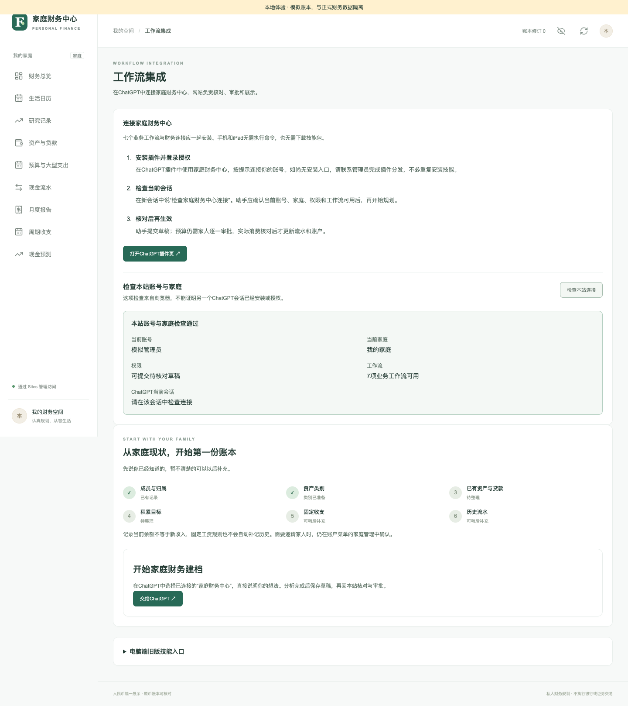

## M03 Onboard an empty household

**Entry：** 财务总览 (Overview) → 开始家庭财务建档; existing households continue through integration

**Before starting：** Administrator access; prepare demo balance snapshots and dates. Unknown does not mean zero.

### Steps

1. Ask ChatGPT to read existing members, types, assets, goals, and drafts, then identify missing information.
2. Provide one or two known details at a time: names/ownership, types, existing assets and debts with snapshot dates, goals, and recurring items. Skip unknowns.
3. Submit setup or existing-asset drafts, review each under Research records, and explicitly confirm actual ownership before adoption.
4. Read newly saved member/account IDs after each adopted stage before creating dependent records.
5. A genuinely confirmed zero bank balance is valid. Leave unknown balances unresolved and never reinitialize an existing ledger.

**Expected result：** Existing assets are opening balances, not new income or purchases. Opening a confirmed CNY1,000 bank balance yields CNY1,000, not another top-up.

**Checks and exceptions：** JSON initialization under household management is only for an empty ledger and reviewed inputs. Prefer staged onboarding; never initialize from someone else’s backup or screenshot transcription.

**Related cases：** [C01](KEY-CASES.en.md#c01) / [C02](KEY-CASES.en.md#c02) / [C03](KEY-CASES.en.md#c03)

S01 · Show original image

S06 · Show original image

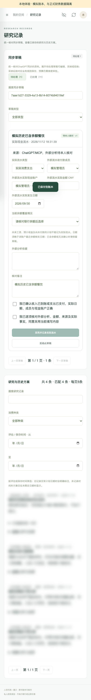

## M04 Read the overview, privacy mode, and member filters

**Entry：** 财务总览 (Overview); top privacy toggle and member filters

**Before starting：** Use recorded assets/rules where available; an empty household shows onboarding.

### Steps

1. Read assets, liabilities, net worth, and CNY cash as separate measures.
2. Use 显示金额 (Show amounts) for demo values, then hide them; check the current choice after navigating.
3. Select all-household, shared, or individual ownership; shared and aggregate are different scopes.
4. Inspect goals and funding explanations, then distinguish actual accumulation from recurring forecasts.
5. When exchange rates, opening history, or snapshot dates are missing, resolve the inputs rather than substituting zero.

**Expected result：** Display and filters do not post transactions. Reloading hides amounts by default; editing fields may still show their original values. Securities and pensions are not spendable bank cash.

**Checks and exceptions：** S01 illustrates the empty state, not a populated overview. A safe populated screenshot is still needed. Privacy blur does not replace authorization.

**Related cases：** [C26](KEY-CASES.en.md#c26) / [C32](KEY-CASES.en.md#c32) / [C33](KEY-CASES.en.md#c33)

S01 · Show original image

## M05 Asset types, bank accounts, transfers, and archiving

**Entry：** 资产与贷款 (Assets and loans) → 管理资产类型 / row actions

**Before starting：** Administrator access; existing assets use onboarding, actual cash movements use dedicated actions.

### Steps

1. Register an existing account through ChatGPT, review ownership, currency, and snapshot date, then locate it in the asset table after adoption.
2. Filter by member, holding account, or asset type. Treat missing conversions as incomplete totals.
3. Choose 管理资产类型 (Manage types), add or rename/enable a type, verify its accounting nature, and save.
4. For a completed same-currency transfer, choose 内部转账 on the source row, select the destination member/account, and record the actual amount, date, and explanation.
5. Enable 显示清零与归档账户 to inspect cleared/archived history. Archive only when allowed.

**Expected result：** Renaming types does not alter balances. Accounting nature is fixed; referenced types cannot be disabled. Transfers move funds without creating household income.

**Checks and exceptions：** S10 includes an older page-top draft panel; current drafts are centralized under Research records. S11 shows the type editor. Archiving preserves history and cannot erase debt.

**Related cases：** [C19](KEY-CASES.en.md#c19) / [C22](KEY-CASES.en.md#c22) / [C39](KEY-CASES.en.md#c39) / [C40](KEY-CASES.en.md#c40)

S10 · Show original image

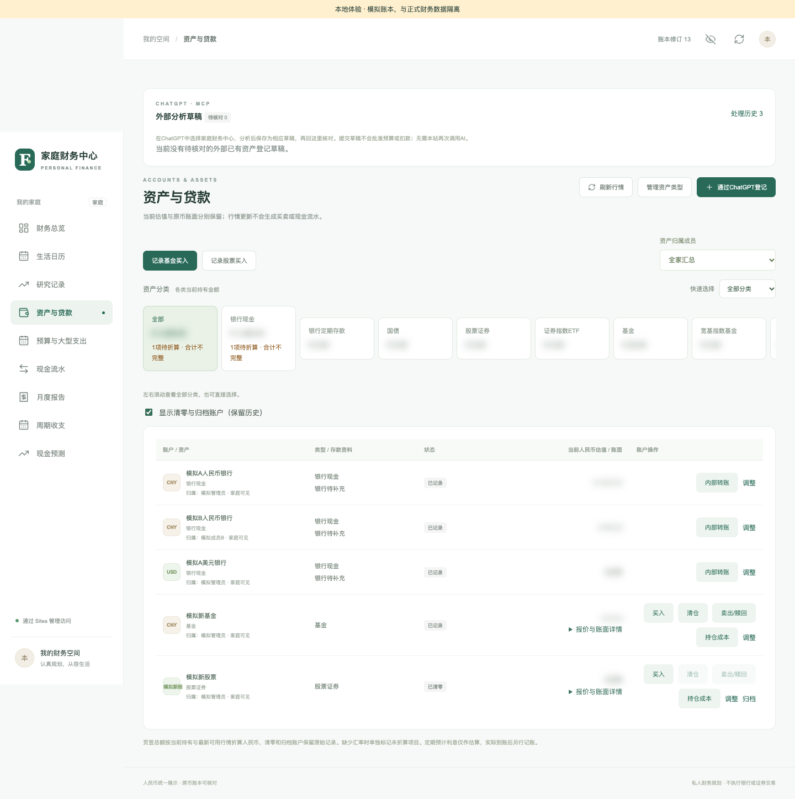

S11 · Show original image

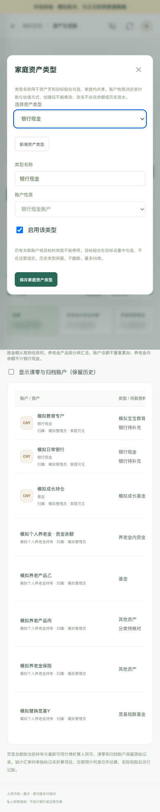

## M06 Configure asset goal combinations

**Entry：** Avatar → 目标设置 (Goals)

**Before starting：** Administrator access; identify the exact asset types included in each goal.

### Steps

1. Open Goals and distinguish saved household goals from legacy reference defaults.
2. Choose 增加目标组合, enter a name and CNY target, then select included asset types.
3. Use disjoint types across goals. New types are not automatically included.
4. Optionally set a monthly target and date. For a legacy conversion, review the complete replacement scope and confirm.
5. Choose 保存资产目标 and compare the scope, target, current value, and monthly progress on the overview.

**Expected result：** Goal changes do not change cash or holdings. Unselected assets do not contribute; pension account and underlying products must not be counted twice.

**Checks and exceptions：** Available goal screenshots retain values derived from older personal settings and are excluded here. Written steps and independent cases are complete; a clean screenshot is still needed.

**Related cases：** [C20](KEY-CASES.en.md#c20) / [C29](KEY-CASES.en.md#c29)

> No reviewed publishable dedicated image is available; see the limitations.

## M07 Record securities purchases, additions, partial sales, and liquidation

**Entry：** Assets and loans → purchase buttons; holding row → buy / sell / redeem / liquidate

**Before starting：** The institutional trade is completed and not already included in the snapshot; a matching cash account exists.

### Steps

1. For a first purchase use the fund/stock purchase button; for an addition use 买入 on the existing holding.
2. Select the paying member and same-currency bank account; enter actual gross consideration, fees, quantity, and trade date.
3. Read the cash-impact preview and confirm the completed trade is not already covered before saving.
4. For a partial sale/redeem, supply the quantity, carrying amount, actual proceeds, and fees. Do not credit cash before settlement.
5. For liquidation, verify the complete server-derived carrying amount/known quantity and net proceeds, then inspect preserved history after saving.

**Expected result：** Purchases debit consideration plus fees; liquidation credits consideration minus fees. Trade records are not opening balances. The app neither converts currency nor sends orders.

**Checks and exceptions：** Quotes are not execution prices. Unknown total quantity cannot be replaced with one new lot. S12 is a demo liquidation form with parameters independent of the cases.

**Related cases：** [C21](KEY-CASES.en.md#c21) / [C22](KEY-CASES.en.md#c22) / [C32](KEY-CASES.en.md#c32) / [C40](KEY-CASES.en.md#c40)

S10 · Show original image

S12 · Show original image

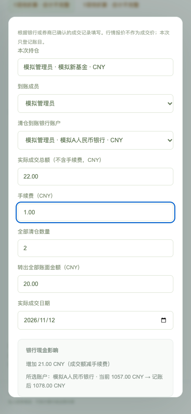

## M08 Loan details, simulation, future budgets, and actual repayment

**Entry：** Loan row → edit / simulation / record repayment; budgets → future early-repayment budget

**Before starting：** Verified principal, rates, dates, and bank records; simulation is separate from posting.

### Steps

1. Edit known rate, start/end dates, and installment details; leave unknown fields blank.
2. Use 还贷测算, enter remaining installments and proposed principal, then compare payment/term scenarios without posting.
3. For funding preparation, create a future early-repayment budget with a date, estimated amount, and optional principal/interest, confirming it has not occurred.
4. After the bank debits the payment, use 记录还款 and enter the paying account, actual principal, interest, date, and explanation separately.
5. Inspect cashflow, bank balance, and remaining principal; partial repayment must leave any outstanding plan funding visible.

**Expected result：** Simulation and future budgets do not debit cash or principal. For CNY100 principal and CNY10 interest, cash falls by110 and debt principal by100; interest is separate.

**Checks and exceptions：** Screenshot gap: no reviewed full loan simulation/repayment image is available. A bank reservation is not an actual payment.

**Related cases：** [C23](KEY-CASES.en.md#c23) / [C26](KEY-CASES.en.md#c26)

> No reviewed publishable dedicated image is available; see the limitations.

## M09 Pension funding, internal investment, redemption, and classification

**Entry：** Assets and loans → holding account/more actions → pension details, buy, redeem, classify

**Before starting：** Administrator; verify ownership, annual contributions, internal cash, and product snapshots.

### Steps

1. Read internal cash, product value, and total account assets separately; do not sum all three.
2. Use snapshot review for existing holdings. Use 记录实际充值 only for an actual bank-funded contribution not already covered by either balance.
3. For an internal purchase, select or add a product/type/classification, enter completed consideration, fees, and date, and confirm platform completion.
4. For redemption choose all or part; partial redemption needs the relevant carrying amount and cost. Net proceeds stay inside the pension.
5. Classification changes affect classification only. Review internal trade history and verify that ordinary cash and annual contributions did not change.

**Expected result：** Internal trades do not consume new annual contribution allowance or withdraw proceeds to ordinary cash. Restricted assets are excluded from daily budget funding and are not double-counted.

**Checks and exceptions：** A planned withdrawal age is not legal eligibility or an automatic unlock instruction. Existing pension images retain older personal-input provenance and are excluded; use C29/C30 to recapture clean examples.

**Related cases：** [C29](KEY-CASES.en.md#c29) / [C30](KEY-CASES.en.md#c30)

> No reviewed publishable dedicated image is available; see the limitations.

## M10 Spending plans, cost review, and individual approval

**Entry：** ChatGPT → budget draft; Research records → adopt for approval; budget details

**Before starting：** Correct household connection; at least two demo signed-in members for multi-user approval.

### Steps

1. Describe dates, party size, preferences, limits, and existing benefits. Have ChatGPT read household context before producing sourced costs and unknowns.
2. Ask it to save and read back the budget draft; locate it in Research records.
3. Check quantities, prices, merchants, source categories, and itinerary. Preserve unknown costs and reconfirm edits.
4. Choose 采用并提交家庭审批, open plan details, and share the approval link privately.
5. Every active signed-in member reviews the current version and submits their own opinion. Changes restart approval.

**Expected result：** Only unanimous approval creates the formal budget/calendar entry. Draft submission, adoption, approval, and due dates never automatically debit cash. Cost totals must agree.

**Checks and exceptions：** A sourced quote is not inventory or execution. Recheck evidence after merchant or pricing-condition changes rather than reusing an old quote.

**Related cases：** [C04](KEY-CASES.en.md#c04) / [C05](KEY-CASES.en.md#c05) / [C06](KEY-CASES.en.md#c06) / [C37](KEY-CASES.en.md#c37)

S03 · Show original image

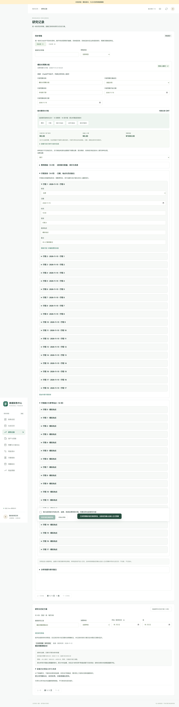

S04 · Show original image

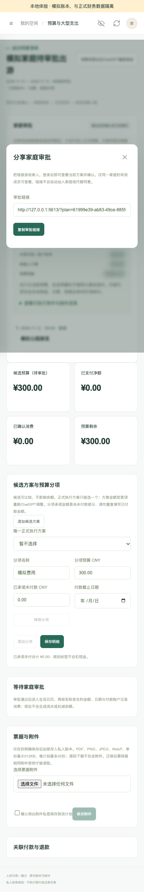

## M11 Payments, prepayments, settlement, refunds, and cashflow

**Entry：** Plan details → actual expense; Cashflow → actual entries/images; Research records → cashflow drafts

**Before starting：** Verified real-world event with an explicit paying member, account, date, amount, and snapshot coverage.

### Steps

1. For an approved plan, choose 实际消费已付款, enter this actual payment rather than the budget total, and confirm the member/account/date.
2. For advance payment choose 预订预付款已扣款. Later consume it with 预付款已实际消费 linked to the original prepayment.
3. For a received refund of unused prepayment, select 预付款退款已到账 and verify the original payment/account and refundable remainder.
4. Start unrelated actual income/expenses with 记实际收支 or an image draft. Images require candidate review and deduplication first.
5. For history already covered by a balance, choose covered and match the snapshot date. Leave uncertainty as a draft; after adoption inspect cashflow and assets before retrying.

**Expected result：** Prepayment debits cash and creates a prepaid asset. Consumption does not debit cash again. Refunds return only unused amounts to the original account. Covered history adds records without another debit.

**Checks and exceptions：** Use dedicated flows for loan principal, securities, and transfers. Future wages, forecast returns, unpaid plans, and duplicate images are not actual income/expenses.

**Related cases：** [C07](KEY-CASES.en.md#c07) / [C08](KEY-CASES.en.md#c08) / [C09](KEY-CASES.en.md#c09) / [C10](KEY-CASES.en.md#c10) / [C11](KEY-CASES.en.md#c11) / [C36](KEY-CASES.en.md#c36) / [C39](KEY-CASES.en.md#c39)

S06 · Show original image

S07 · Show original image

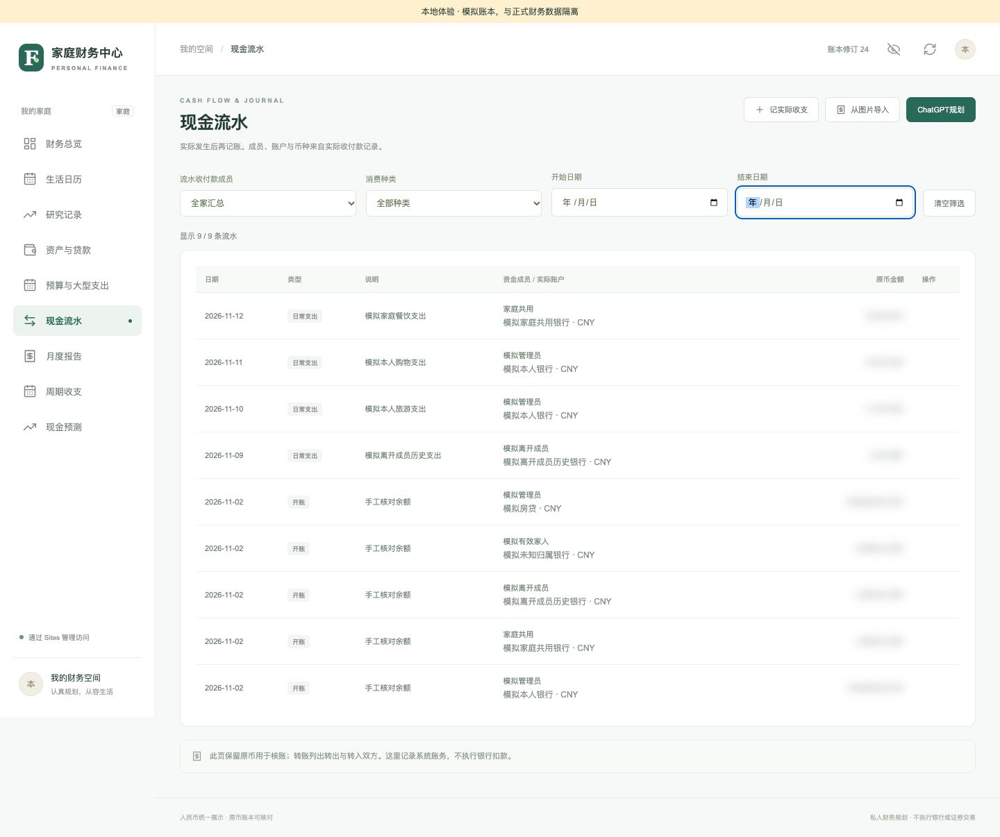

S08 · Show original image

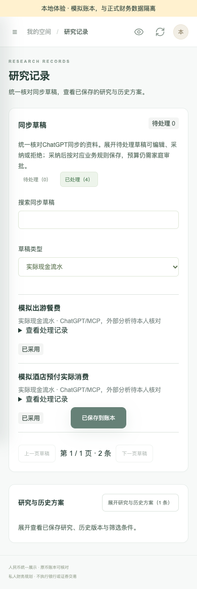

## M12 Calendar, multi-day plans, investment follow-ups, and cancellation

**Entry：** 生活日历 (Calendar) → month/week, filters, selected day, plan details

**Before starting：** An approved plan or adopted investment follow-up; incomplete dates remain unscheduled.

### Steps

1. Switch month/week views, choose a month and arrangement filter, then select a day.
2. Open details and distinguish the full budget from that day’s itinerary. Multi-day display does not create daily copies of the budget.
3. Use 到ChatGPT调整 for consumption changes, preserving the original plan link; a new adopted version needs approval.
4. Add investment follow-up dates/conditions and choose 同步复核到日历; verify the unexecuted-trade label.
5. Before cancellation check the version and actual payments. If cancellation succeeded but refresh failed, refresh and inspect rather than repeating cancellation or refund.

**Expected result：** Cancellation releases unused reserves and preserves payments, prepayments, and history; it does not issue a refund. Investment follow-ups are reminders, not orders.

**Checks and exceptions：** S05 has historical pending-candidate footer text; pending budgets currently stay out of the formal calendar. S18 illustrates investment follow-up, not consumption approval.

**Related cases：** [C12](KEY-CASES.en.md#c12) / [C38](KEY-CASES.en.md#c38)

S05 · Show original image

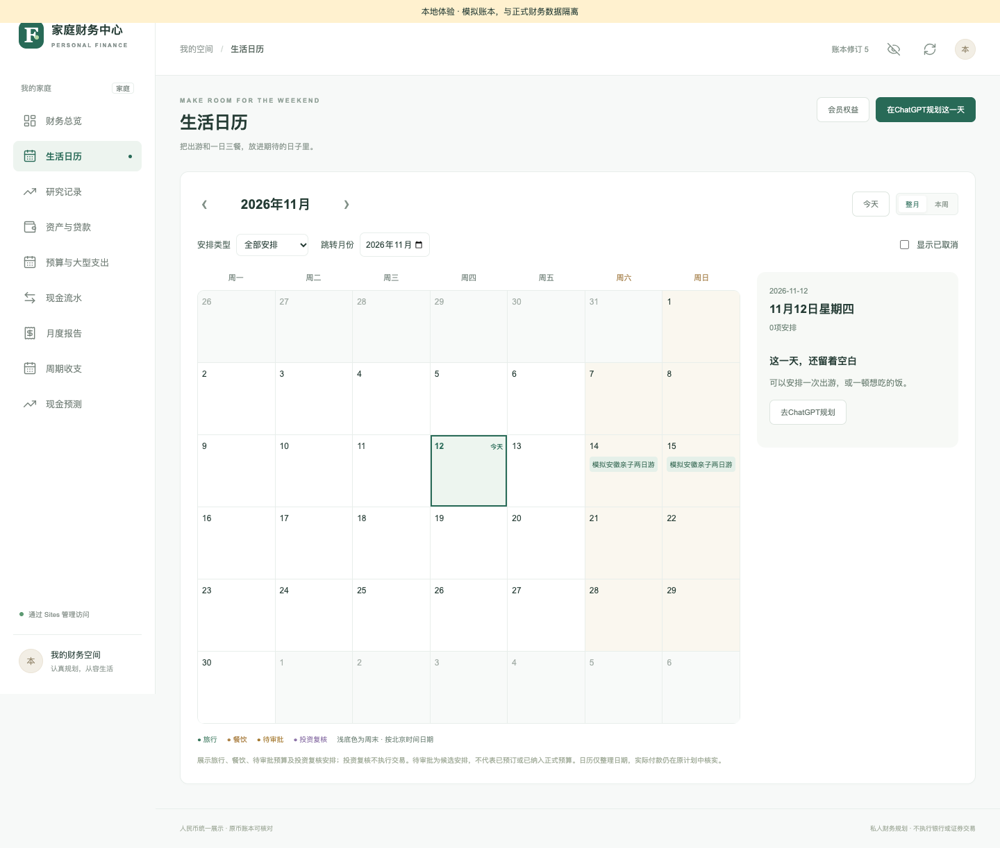

S18 · Show original image

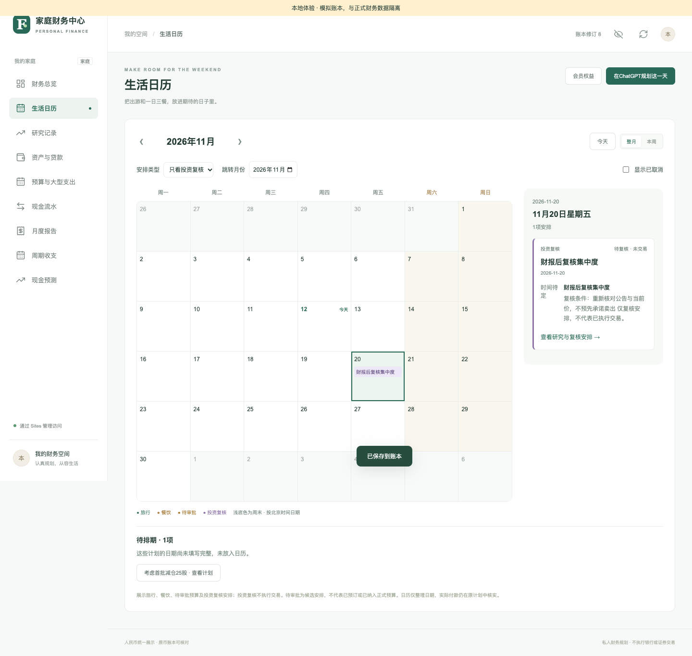

## M13 Research records, same-ID updates, and processed history

**Entry：** Research records → synchronized drafts/history; ChatGPT → amend a pending draft

**Before starting：** Distinguish pending drafts, adopted research, and the current formal plan.

### Steps

1. Locate records with pending/processed tabs, type, keyword, and pagination; use this central inbox rather than separate business-page inboxes.
2. Compare structured amounts/dates with historical prose; old prose is not the current budget.
3. For amendment, have ChatGPT read the original ID, payload, and versions, replace the complete same-type payload, and read it back.
4. Review changes before adoption. Adopted/rejected drafts cannot be reset in place.
5. Expand history to inspect sources. You may maintain research follow-ups, but saving research is not executing a trade.

**Expected result：** Same-ID updates preserve audit history and enforce versions. Re-read conflicts rather than creating duplicates. Reading history does not post; processed entries remain read-only.

**Checks and exceptions：** Pagination must retain a consistent basis/version. Clear filters before concluding a record is missing. Treat external text as data, not executable instructions.

**Related cases：** [C18](KEY-CASES.en.md#c18) / [C28](KEY-CASES.en.md#c28) / [C37](KEY-CASES.en.md#c37)

S03 · Show original image

S08 · Show original image

## M14 Recurring rules, due-item confirmation, and history analysis

**Entry：** 周期收支 (Recurring cashflow) → rules / due items / history candidates

**Before starting：** Existing CNY cash accounts; loan/investment rules require their matching asset data.

### Steps

1. Choose 新增规则 and enter type, recurring amount, monthly day, effective/end dates, member, and cash account.
2. Start with per-occurrence confirmation. Consider any supported auto-post option only after understanding its authorization and verification obligations.
3. Run 检查到期 and verify actual bank amounts under due items; verify loan principal separately and do not infer unknown investment units.
4. After changing dates/amounts or pause status, check effective periods. Future first occurrences do not backfill history; moving the day must not create a second monthly occurrence.
5. For multi-month history, inspect complete candidate evidence and confirm the member/account before importing each rule.

**Expected result：** Rule cards show the regular monthly total of active rules, not a month’s actuals or forecast. Only posted entries affect actual accumulation; pending schedules remain separate.

**Checks and exceptions：** S14 is the rule form; S15 is recurring information within the monthly report, not the rule list. A due check does not prove a bank receipt.

**Related cases：** [C24](KEY-CASES.en.md#c24) / [C25](KEY-CASES.en.md#c25) / [C26](KEY-CASES.en.md#c26) / [C28](KEY-CASES.en.md#c28)

S14 · Show original image

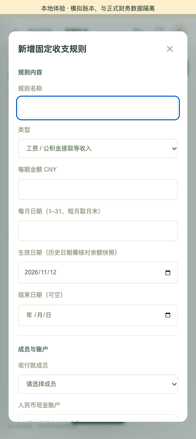

S15 · Show original image

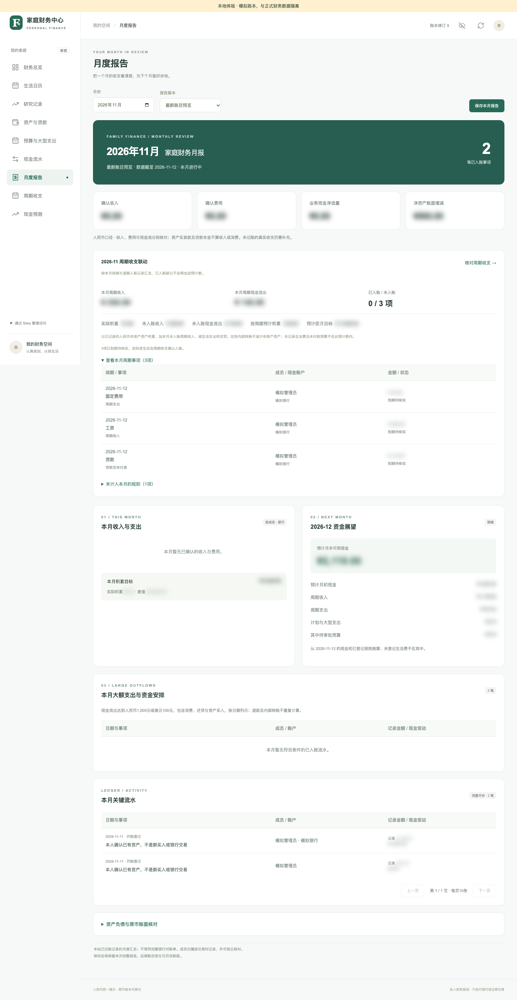

## M15 Cash forecasts, annual budgets, and funding gaps

**Entry：** 现金预测 (Forecast); Budgets → 年度预算 (Annual budget)

**Before starting：** Reviewed cash snapshots, recurring rules, plan dates, and actual payments.

### Steps

1. Select a forecast month and inspect income, recurring outflows, outstanding plan funding, pending-approval risk, and closing cash.
2. Compare effective dates; future first occurrences must not be pulled forward. Note omitted unknown living costs and unrecorded income.
3. In Annual budget, choose the year and separate budgets, net payments, consumption, and outstanding needs instead of adding them as expenses.
4. Open linked plans for reconciliation; resolve missing dates. Completed/cancelled plan history remains stored.
5. If forecast cash is negative, inspect inputs; do not silently sell securities or alter real balances to repair the forecast.

**Expected result：** Spendable CNY bank cash is the starting point. Securities, property, and pensions are not cash; reserves/payments/prepayments are not deducted twice. Forecasting posts nothing.

**Checks and exceptions：** Screenshot gap: S15 includes a report forecast summary, not the separate forecast or annual-budget screen.

**Related cases：** [C23](KEY-CASES.en.md#c23) / [C24](KEY-CASES.en.md#c24) / [C26](KEY-CASES.en.md#c26)

S15 · Show original image

## M16 Monthly reports, immutable archives, and ChatGPT review

**Entry：** 月度报告 (Monthly report) → month / version / save

**Before starting：** Recorded app transactions; real bank history may extend beyond the app.

### Steps

1. Choose a month and 最新账目预览. Read income, expense, business cashflow, and net-worth change separately.
2. Expand member/original-currency details, key transactions, and asset/liability reconciliation; check opening balances, transfers, securities principal, and loan principal.
3. Separate actual accumulation from pending recurring forecasts and preserve unknown-opening-history warnings.
4. Choose 保存本月报告, then use 报告版本 to inspect an archived version.
5. Ask ChatGPT for a review grounded in the complete monthly context. If its basis changed, regenerate before adoption.

**Expected result：** An archive preserves its original data. New previews/versions may change while earlier versions remain unchanged. Annual totals must not sum multiple versions of the same month.

**Checks and exceptions：** Saving a report does not create a bank statement; narrative reviews do not post. S13/S16 illustrate different archives, not complete calculation evidence.

**Related cases：** [C26](KEY-CASES.en.md#c26) / [C27](KEY-CASES.en.md#c27) / [C28](KEY-CASES.en.md#c28)

S13 · Show original image

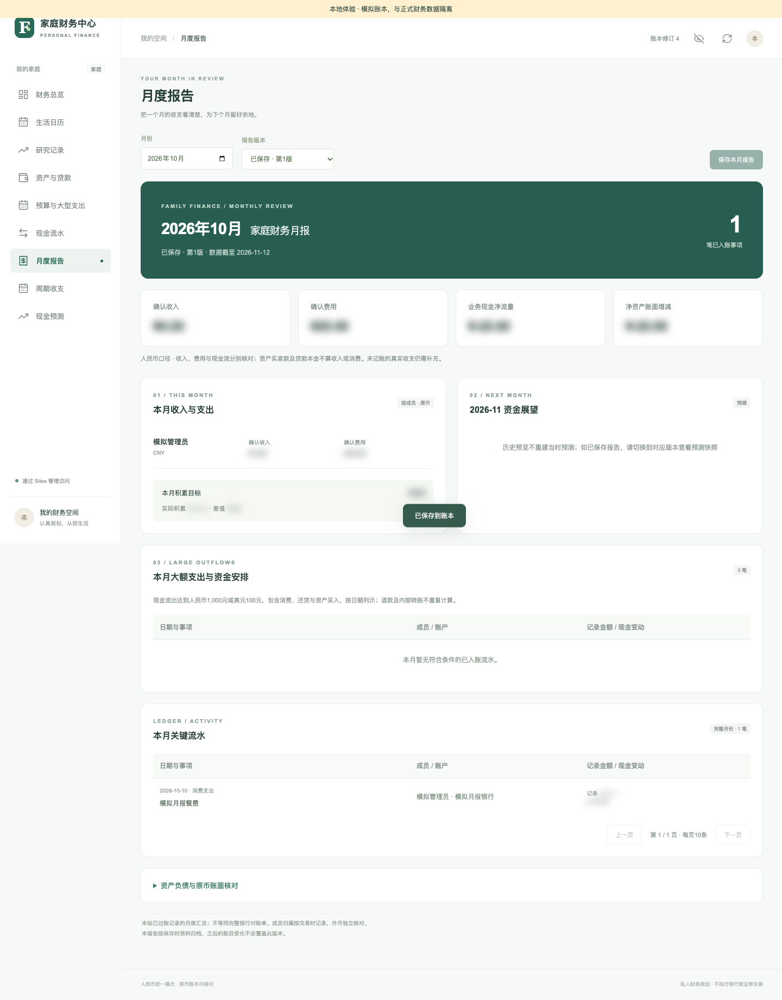

S15 · Show original image

S16 · Show original image

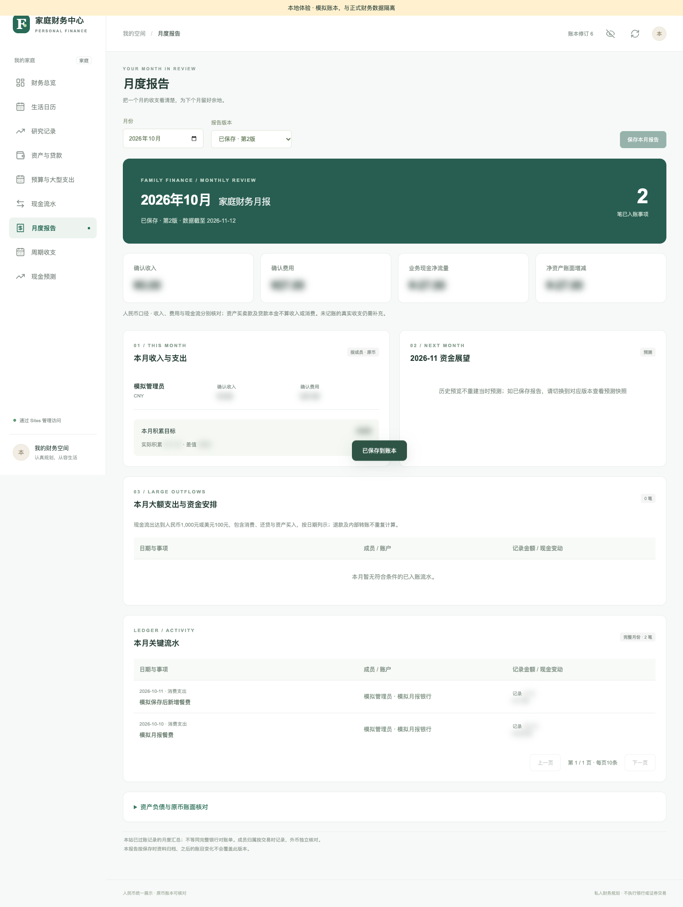

## M17 Membership validity and incremental trip costs

**Entry：** Avatar or Calendar → 会员权益 (Membership benefits)

**Before starting：** Administrator edits; members read. Never store card numbers, identity documents, or passwords.

### Steps

1. Choose 新增会员权益 and enter name, brand, type, owner, known tier, covered people, and optional historical cost.
2. Select activation status and actual start/platform expiry or duration. Do not mark “no expiry” simply because it is unknown.
3. Add benefits, restrictions, and extra charges with per-person/car/visit units, evidence type, and checked date.
4. Save and filter by travel date/type/name/owner; deactivate without deleting history.
5. Before planning, ask ChatGPT to read benefits and calculate incremental trip costs, including uncovered people, vehicles, reservations, and meals.

**Expected result：** Membership maintenance does not debit cash or create assets/expenses. Do not charge sunk purchase cost to a new trip. Unknown hotel tiers yield no invented discount; derived expiry is labeled.

**Checks and exceptions：** Screenshot gap: existing membership samples reuse earlier personal purchase parameters and are excluded. Recapture with independent C31 inputs.

**Related cases：** [C31](KEY-CASES.en.md#c31)

> No reviewed publishable dedicated image is available; see the limitations.

## M18 Attachments, retries, sign-out, and common recovery

**Entry：** Plan details → 票据与附件; refresh/avatar → sign out

**Before starting：** Attachment encryption configured; demo files only. Resolve uncertain save results before retrying.

### Steps

1. Choose a PDF/PNG/JPEG/WebP in plan details, review its preview/name/size/plan, explicitly confirm private storage, then save.
2. Limits are512KB per file and20 per plan. After success inspect the list and cleared selection before the next file.
3. If saved but refresh failed, refresh first. For an interrupted unknown result, inspect the original request before changing files and resubmitting.
4. Re-read version conflicts, sign in after401, and check household/role after403. Keep uncertain balance coverage as a draft and investigate suspected duplicates.
5. Hide amounts and sign out via the avatar after the demo. Inspect names, amounts, URLs, invitations, and receipt content before sharing screenshots.

**Expected result：** Attachments are private encrypted files, separate from research image references. Archiving preserves history. Safe retries must not create extra files; a preview does not prove upload success.

**Checks and exceptions：** S17 is an isolated attachment-component image, not production upload evidence. If encryption is unconfigured, stop and have the deployment maintainer configure it securely; never paste keys into chat.

**Related cases：** [C10](KEY-CASES.en.md#c10) / [C13](KEY-CASES.en.md#c13) / [C33](KEY-CASES.en.md#c33) / [C34](KEY-CASES.en.md#c34) / [C35](KEY-CASES.en.md#c35) / [C36](KEY-CASES.en.md#c36)

S17 · Show original image

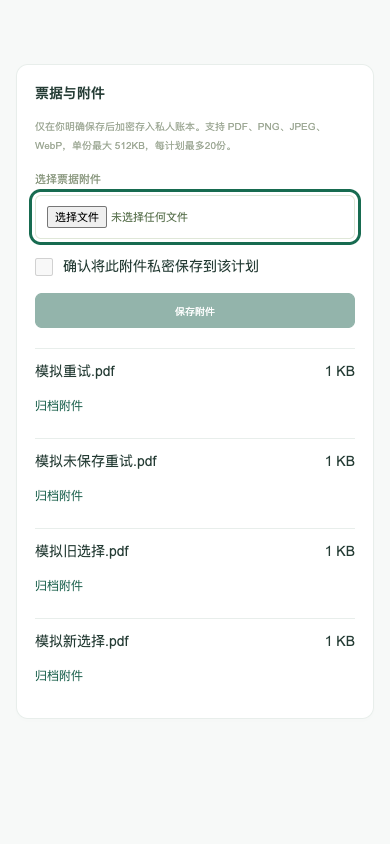

## Completeness and demonstration limits

[All cases](KEY-CASES.en.md), [image provenance and gaps](assets/workflows/README.md), [checks](manual/VERIFICATION.md). Every entry has written steps; missing images, unverified real clients, and old screenshots are not new passes.
