# 产品操作演示手册

[中文](PRODUCT-MANUAL.md) · [English](PRODUCT-MANUAL.en.md) · [单文件图文演示 / Offline illustrated edition](product-demo.html) · [关键案例库](KEY-CASES.md)

面向家庭管理员、家人和演示人员的完整操作说明，按产品入口组织，不以开发需求清单代替操作步骤。18章覆盖当前源码的13个导航/账户菜单入口；关键案例另存40项。

适用基线：2026-11-13本地工作树。当前源码包含尚未发布的插件接入改动，线上可能不同。公开图均为已审查的历史隔离演示或组件产物，不是本轮新拍的生产连续流程。目标、养老金和会员等旧样本有个人参数来源，故未复用；缺口逐章说明。

演示只在独立家庭使用合成数据。D代表演示当天，D-1为前一天；金额均为主币单位，输入字符串，后台分/美分不直接当元使用。用户确认“实际发生”与机构已完成是记账前提，演示不得向真实账本伪造交易。

## 功能入口覆盖

| 入口 | 章节 |
| --- | --- |
| 财务总览 | [M04](#m04) |
| 生活日历 | [M12](#m12) |
| 研究记录 | [M13](#m13) |
| 资产与贷款 | [M05](#m05) / [M07](#m07) / [M08](#m08) / [M09](#m09) |
| 预算与大型支出 | [M10](#m10) / [M11](#m11) / [M15](#m15) |
| 现金流水 | [M11](#m11) |
| 月度报告 | [M16](#m16) |
| 周期收支 | [M14](#m14) |
| 现金预测 | [M15](#m15) |
| 会员权益 | [M17](#m17) |
| 家庭管理 | [M01](#m01) / [M03](#m03) |
| 工作流集成 | [M02](#m02) |
| 目标设置 | [M06](#m06) |

## 章节目录

- [M01 登录、家庭邀请与权限](#m01)
- [M02 连接ChatGPT并检查当前会话](#m02)
- [M03 从空账本完成家庭建档](#m03)
- [M04 阅读总览、隐私模式与成员筛选](#m04)
- [M05 资产分类、银行账户、内部转账与归档](#m05)
- [M06 设置自由组合资产目标](#m06)
- [M07 记录基金股票买入、增持、部分卖出与清仓](#m07)
- [M08 贷款资料、还贷模拟、未来预算与实际还款](#m08)
- [M09 养老金充值、内部投资、赎回与分类](#m09)
- [M10 消费规划、费用核对与逐人审批](#m10)
- [M11 实付、预付款、消费冲抵、退款与现金流水](#m11)
- [M12 日历、跨日计划、投资复核与取消](#m12)
- [M13 研究记录、同ID续改与处理历史](#m13)
- [M14 周期规则、到期核实与历史归并](#m14)
- [M15 现金预测、年度预算与备款缺口](#m15)
- [M16 月报、不可变归档与ChatGPT复盘](#m16)
- [M17 会员权益、有效期与出行增量成本](#m17)
- [M18 票据附件、重试、登出与常见故障](#m18)

## 演示主线：从计划到实际消费

先按C01在隔离家庭登记银行1000元，再用C04/C05演示300元预算与多人审批，接着按C09逐步演示款项，最后按C27保存并比较月报。以下是预期账务轨迹，不是本轮手工演示的已通过回执。

| 步骤 | 银行现金 | 预付资产 | 应核对 |
| --- | ---: | ---: | --- |
| 开账及预算批准 | 1000 | 0 | 预算300不扣现 |
| 实付120 | 880 | 0 | 原计划关联与成员账户 |
| 预付50 | 830 | 50 | 预付不是已消费 |
| 从预付消费30 | 830 | 20 | 不再次扣现金 |
| 未消费20退款到账 | 850 | 0 | 退原账户；累计实际消费150 |

## M01 登录、家庭邀请与权限

**入口：** 站点登录 → 右上角头像 → 家庭管理

**开始前：** 准备两个独立演示账号；不要使用真实邀请链接或其他家庭资料。

### 操作步骤

1. 用自己的ChatGPT账号登录；未加入家庭时先核对邀请来源。
2. 管理员打开家庭管理，确认家庭名称，点击“生成邀请链接”；只私下发给对应家人。
3. 家人打开邀请，用自己的账号登录，核对家庭名称后点击“确认加入家庭”。
4. 回到成员表确认管理员/只读身份；在“家庭记账成员”添加昵称，必要时关联已加入账号。
5. 需要变更权限时选择“移除成员”“转移管理”或成员自己的“退出家庭”，阅读确认说明再提交。

**预期结果：** 登录成员能查看本家庭，普通成员不能一般财务写入，但可以提交本人预算意见。昵称不是登录权限；管理权转移不改变历史资产归属。

**核对与异常：** 邀请一次使用、7天有效，可撤销；泄露有效邀请可能让持有人加入。管理员须先转移管理再退出。截图待补：当前无可公开的完整邀请与第二真实账号演示图。

**关联案例：** [C13](KEY-CASES.md#c13) / [C14](KEY-CASES.md#c14) / [C15](KEY-CASES.md#c15) / [C16](KEY-CASES.md#c16) / [C17](KEY-CASES.md#c17)

> 暂无已审查可公开的本模块专属截图，详见核对说明。

## M02 连接ChatGPT并检查当前会话

**入口：** 头像 → 工作流集成；ChatGPT → 已连接应用

**开始前：** 网站账号与ChatGPT会话连接分别验证；插件注册和分发尚有外部环节。

### 操作步骤

1. 打开“工作流集成”，阅读插件接入说明；没有实际安装入口时由维护者完成分发，不猜插件地址。
2. 点击“检查本站连接”，核对当前账号、家庭、权限及业务工作流数量。
3. 在已连接的ChatGPT新会话说“检查家庭财务中心连接”，让助手核对该会话的连接状态。
4. 连接有效后说“先读取已有数据，帮我规划……”；网页准备过任务时说“继续网站中准备的任务”。
5. 手机/iPad使用实际可用的已连接会话；电脑端旧技能安装入口仅供已有MCP的Codex环境。

**预期结果：** 本站检查不读余额或流水、不修改账本；网页通过不能替另一会话承诺安装成功。当前七个业务入口，连接检查属于附加能力。

**核对与异常：** S09为本地新增界面，不证明已上线、已进插件目录或真实iPad安装成功。401后重新登录并重新检查，不保留旧成功结论。

**关联案例：** [C35](KEY-CASES.md#c35)

S09 · 展开原图

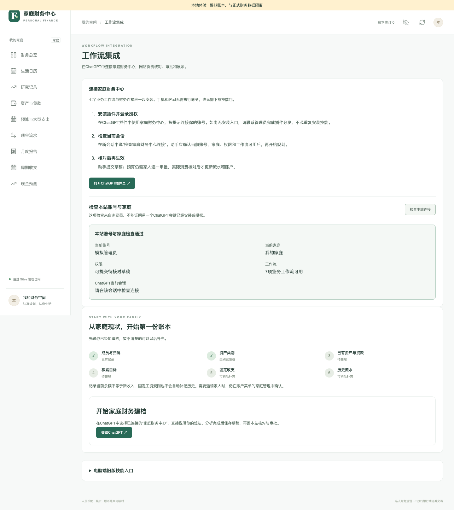

## M03 从空账本完成家庭建档

**入口：** 财务总览 → 开始家庭财务建档；已有家庭从工作流集成继续

**开始前：** 管理员；先收集演示资产余额和核对日期，未知不要填0。

### 操作步骤

1. 进入建档，先让ChatGPT读取已有成员、类别、资产、目标和草稿，列出缺项。
2. 逐轮提供一两项已知资料：称呼/归属、类别、现有资产负债及余额日期、目标、固定收支；允许跳过。
3. ChatGPT提交建档配置或已有资产草稿；回“研究记录”逐项检查，已有资产勾选确认持有事实后采用。
4. 每段采用后重新读取真实成员/账户ID，再继续依赖这些记录的下一段。
5. 银行真实余额为0可以登记；缺失余额保留未知，不重建覆盖已有账本。

**预期结果：** 已有资产以开账记录，不是新增收入或新买入；登记1000元已有银行余额，余额为1000元，不再产生一笔向银行充值。

**核对与异常：** 家庭管理的JSON初始化仅适用于空账本和已核对资料；普通用户优先逐段建档，不把别人备份或截图转录当初始化数据。

**关联案例：** [C01](KEY-CASES.md#c01) / [C02](KEY-CASES.md#c02) / [C03](KEY-CASES.md#c03)

S01 · 展开原图

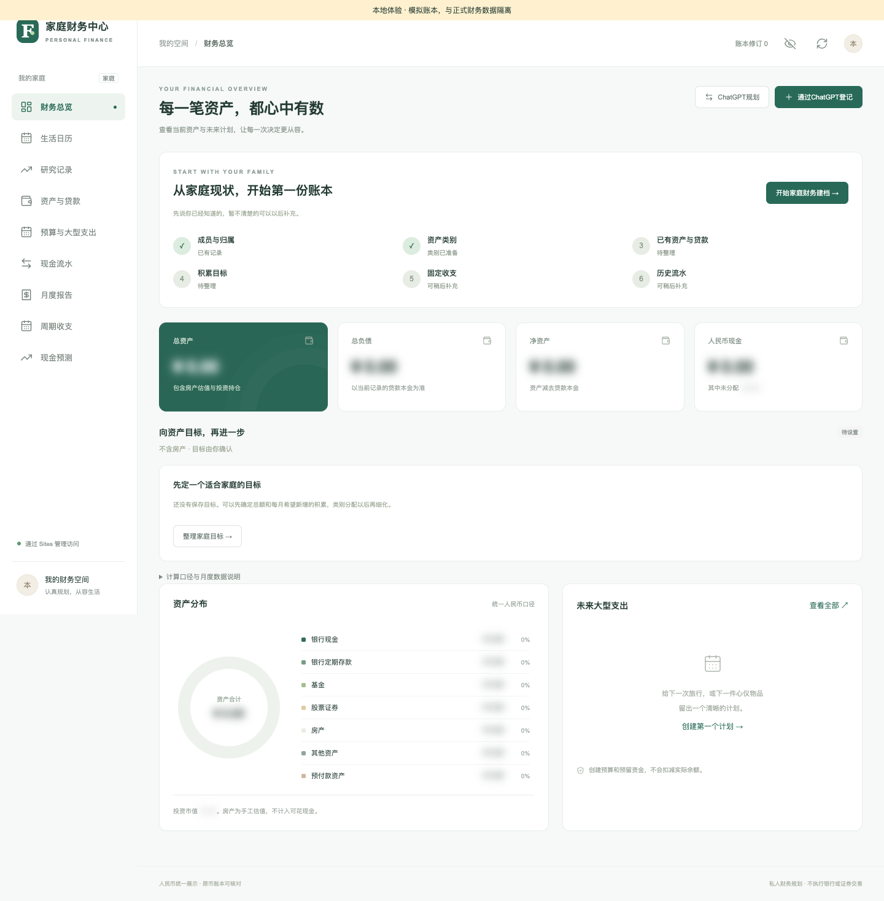

S06 · 展开原图

## M04 阅读总览、隐私模式与成员筛选

**入口：** 财务总览；顶部眼睛与成员筛选

**开始前：** 已有资产/规则时读数据；空家庭会显示建档空态。

### 操作步骤

1. 先看总资产、总负债、净资产和人民币现金，确认它们代表不同口径。
2. 点击顶部“显示金额”查看演示数值，再点击隐藏；切换栏目后核对当前选择。
3. 选择全家汇总、家庭共用或某位成员，核对资产归属范围，不把共用和汇总当同义词。
4. 展开目标与备款说明，比较用户目标、当前积累、未付计划与银行现金；再看实际/预计周期变化。
5. 遇到缺汇率、缺期初、余额日期不足或待核对提示时，先补资料，不自行把未知补成0。

**预期结果：** 显示与筛选只改变视图，不写流水。刷新/重新打开默认隐藏金额；编辑输入仍可能显示原值。证券和养老金不等于可花银行现金。

**核对与异常：** S01是空态示例，不展示完整持仓后的总览。完整数据总览截图待补；隐私模糊不能替代权限控制。

**关联案例：** [C26](KEY-CASES.md#c26) / [C32](KEY-CASES.md#c32) / [C33](KEY-CASES.md#c33)

S01 · 展开原图

## M05 资产分类、银行账户、内部转账与归档

**入口：** 资产与贷款 → 管理资产类型 / 账户行操作

**开始前：** 管理员；已有资产走建档，实际资金变动走专用操作。

### 操作步骤

1. 通过ChatGPT登记已有账户，核对成员、币种和余额日期；回研究记录采用后在资产表找到记录。
2. 用归属成员、持有账户和分类筛选定位；缺估值时读“待折算”，不要把合计当完整数。
3. 点击“管理资产类型”，新增或改名、启用；核对账户性质，保存后返回资产表。
4. 同币种银行账户之间已发生转账时，在转出行点“内部转账”，选转入成员与账户，填实际金额、日期和说明，确认到账。
5. 零余额/清仓账户需查历史时勾选“显示清零与归档账户（保留历史）”；只在满足条件时归档。

**预期结果：** 改分类名不改余额；类型性质创建后不能改，仍被账户或目标引用时不能停用。内部转账只移动资金，不产生家庭收入。

**核对与异常：** S10保留旧版页顶草稿区，当前草稿统一在研究记录；S11只展示类型维护表单。归档保留历史，不能用来抹掉欠款。

**关联案例：** [C19](KEY-CASES.md#c19) / [C22](KEY-CASES.md#c22) / [C39](KEY-CASES.md#c39) / [C40](KEY-CASES.md#c40)

S10 · 展开原图

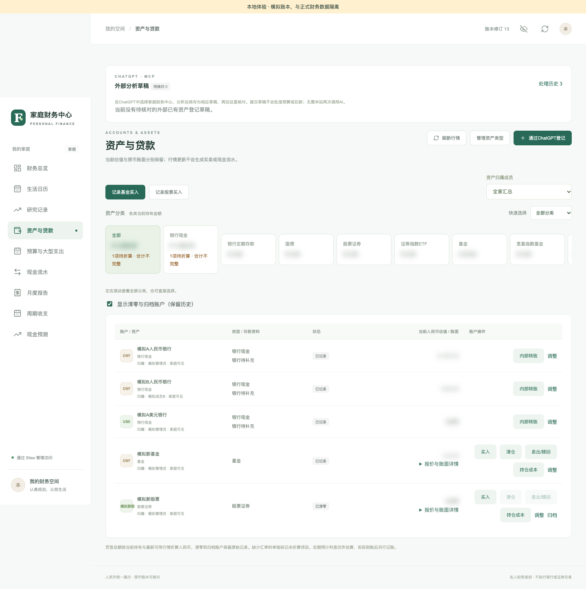

S11 · 展开原图

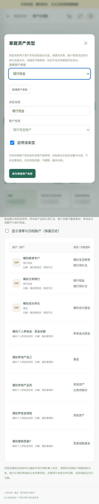

## M06 设置自由组合资产目标

**入口：** 头像 → 目标设置

**开始前：** 管理员；确认要计入目标的真实资产类型。

### 操作步骤

1. 打开目标设置，读取现有组合，区分已保存目标与旧默认参考值。
2. 点“增加目标组合”，填写名称和人民币目标金额，展开类型选择并勾选范围。
3. 其他组合使用不同类型，不把同一类型重复计入两个目标；新类别不会自动进目标。
4. 按需填每月积累与目标日期，未知可留空；旧版本切换时核对完整替换范围并确认。
5. 点击“保存资产目标”，回总览比较范围、总目标、完成额和月目标。

**预期结果：** 修改目标不改变银行或持仓。未勾选资产不计进度；整体养老金与底层产品按去重规则统计，不能叠加。

**核对与异常：** 公开可用目标截图仍包含旧个人参数来源，本版不收录。当前有完整文字步骤和独立案例，清洁截图待补。

**关联案例：** [C20](KEY-CASES.md#c20) / [C29](KEY-CASES.md#c29)

> 暂无已审查可公开的本模块专属截图，详见核对说明。

## M07 记录基金股票买入、增持、部分卖出与清仓

**入口：** 资产与贷款 → 记录基金买入/记录股票买入；持仓行 → 买入/卖出/赎回/清仓

**开始前：** 交易已在机构完成，银行余额未重复包含；有同币种真实现金账户。

### 操作步骤

1. 首次买入点顶部基金/股票买入，或在已有持仓行点“买入”；核对持仓、成员及分类。
2. 选资金成员与同币种银行账户，填写实际成交总额、手续费、数量和成交日期。
3. 先读银行现金影响，确认实际成交及余额未重复包含，再保存。
4. 部分卖出从“卖出/赎回”核对本次数量、对应账面金额、实际回款和费用；未到账不提前记银行现金。
5. 全部清仓选择“清仓”，核对服务器带出的完整账面与已知数量、净到账；保存后查看历史，再确认零持仓可见性。

**预期结果：** 买入扣成交额加费用；清仓增加成交额减费用。实际交易记录不是OPENING；不自动换汇、不向券商下单。

**核对与异常：** 报价不是成交价；数量未知不得用本次买入量冒充全部持仓。S12为模拟清仓表单，图片参数与案例参数独立。

**关联案例：** [C21](KEY-CASES.md#c21) / [C22](KEY-CASES.md#c22) / [C32](KEY-CASES.md#c32) / [C40](KEY-CASES.md#c40)

S10 · 展开原图

S12 · 展开原图

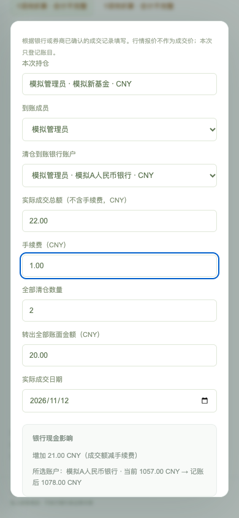

## M08 贷款资料、还贷模拟、未来预算与实际还款

**入口：** 资产与贷款 → 贷款行“调整/还贷测算/记录还款”；预算页 → 登记未来提前还款预算

**开始前：** 贷款本金、利率、起止日期和银行记录已核对；模拟与记账分开。

### 操作步骤

1. 在贷款行调整已知利率、起止日和月供资料，未知项留空。
2. 点“还贷测算”，填写剩余期数、拟还本金与方案，计算后比较月供或期限，不保存为实际还款。
3. 要备款时到预算页“登记未来提前还款预算”，填计划日期、预计金额和可选本金/利息，确认尚未发生。
4. 银行实际扣款后回“记录还款”，选付款账户，分别填实际本金和利息、日期与核对说明。
5. 确认后查看现金流水、银行余额和剩余贷款；部分还款核对计划仍需备款。

**预期结果：** 模拟和未来预算不减少本金或银行现金。实际本金100元、利息10元时现金减110元、贷款本金减100元，利息另列。

**核对与异常：** 截图待补：当前没有经过公开资料检查的完整贷款模拟与还款画面。银行预约不是实际扣款。

**关联案例：** [C23](KEY-CASES.md#c23) / [C26](KEY-CASES.md#c26)

> 暂无已审查可公开的本模块专属截图，详见核对说明。

## M09 养老金充值、内部投资、赎回与分类

**入口：** 资产与贷款 → 持有账户/更多操作 → 账户明细、账户内买入、账户内赎回、调整分类

**开始前：** 管理员；核对同成员银行账户、年度已缴、内部资金和产品快照。

### 操作步骤

1. 打开养老金账户明细，分别读内部可投资余额、产品市值和账户总资产，不把三项相加。
2. 已有快照只核对持仓；实际从银行充值才点“记录实际充值”，确认已到账且未被两个余额重复包含。
3. 内部买入选已有或新产品、种类和分类，填实际成交额、费用、日期，并确认平台已完成。
4. 赎回选择全部或部分；部分赎回核对对应账面和成本，净回款留在该养老金内。
5. 调整分类只改分类，不重写金额；展开账户内投资记录，检查普通银行及年度实缴没有因内部交易变化。

**预期结果：** 内部买卖不消耗新的年度缴费额度，不把赎回款提到普通银行。受限资金不用于日常预算备款，账户与底层产品不重复统计。

**核对与异常：** 领取年龄是个人规划，不能当法定资格或自动解锁指令。现有养老金图保留旧个人参数来源，本版不公开；按C29/C30复演并补清洁图。

**关联案例：** [C29](KEY-CASES.md#c29) / [C30](KEY-CASES.md#c30)

> 暂无已审查可公开的本模块专属截图，详见核对说明。

## M10 消费规划、费用核对与逐人审批

**入口：** ChatGPT → 保存预算草稿；研究记录 → 采用并提交家庭审批；预算详情

**开始前：** 已连接正确家庭，至少两位演示登录成员可验证多人审批。

### 操作步骤

1. 说明日期、人数、偏好、上限及已有权益，先让ChatGPT读取家庭依据，再生成带来源和未知项的计划。
2. 要求保存预算草稿并回读；回研究记录按类型/关键词找到并展开。
3. 逐项核对数量、单价、商家、费用来源及行程；未知费用保留未知，修改后重新确认。
4. 选择“采用并提交家庭审批”，打开预算详情；发给家人的审批链接只私下分享。
5. 每位有效登录成员核对同一当前版本并提交本人意见；修改金额/日期/归属后重新审批。

**预期结果：** 全体同意才进入正式预算与日历；草稿保存、采用、审批和到期均不自动扣现金。费用清单合计必须一致。

**核对与异常：** 来源报价不代表库存/成交；修改商家或计价条件后重核来源，不能只改小计继续沿用旧报价。

**关联案例：** [C04](KEY-CASES.md#c04) / [C05](KEY-CASES.md#c05) / [C06](KEY-CASES.md#c06) / [C37](KEY-CASES.md#c37)

S03 · 展开原图

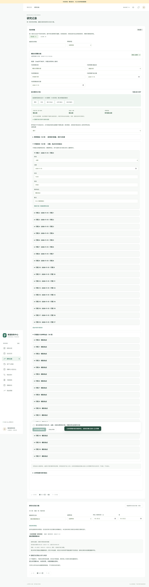

S04 · 展开原图

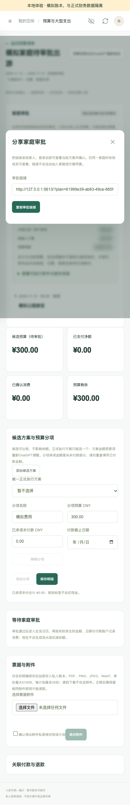

## M11 实付、预付款、消费冲抵、退款与现金流水

**入口：** 预算详情 → 记录实际消费；现金流水 → 记实际收支/从图片整理；研究记录 → 实际流水草稿

**开始前：** 实际事实已核对，明确付款成员、账户、日期、金额与余额覆盖。

### 操作步骤

1. 已审批计划实际付款：在详情选“实际消费已付款”，填本次实付而非预算总额，选成员/账户和实际日期，确认入账。
2. 提前付款：选“预订预付款已扣款”；实际消费时选“预付款已实际消费”并关联原预付款。
3. 未消费部分已退款：选“预付款退款已到账”，核对原预付款和原账户，只退可退余额。
4. 不关联计划的实际收支从现金流水“记实际收支”或图片草稿开始；图片先做候选校对和排重，再确认。
5. 已有余额覆盖的历史选择“已包含”，匹配余额核实日期；无法确认就保留草稿。采用后回流水及资产核对，结果不明先查原记录。

**预期结果：** 预付款先减银行、增预付资产；消费冲抵不再扣银行；退款只将未消费部分退回原账户。已含余额历史只补记录。

**核对与异常：** 贷款本金、证券买卖及内部转账使用专用入口。未来工资、预计收益、未付款计划和重复图片都不能当实际收入/费用。

**关联案例：** [C07](KEY-CASES.md#c07) / [C08](KEY-CASES.md#c08) / [C09](KEY-CASES.md#c09) / [C10](KEY-CASES.md#c10) / [C11](KEY-CASES.md#c11) / [C36](KEY-CASES.md#c36) / [C39](KEY-CASES.md#c39)

S06 · 展开原图

S07 · 展开原图

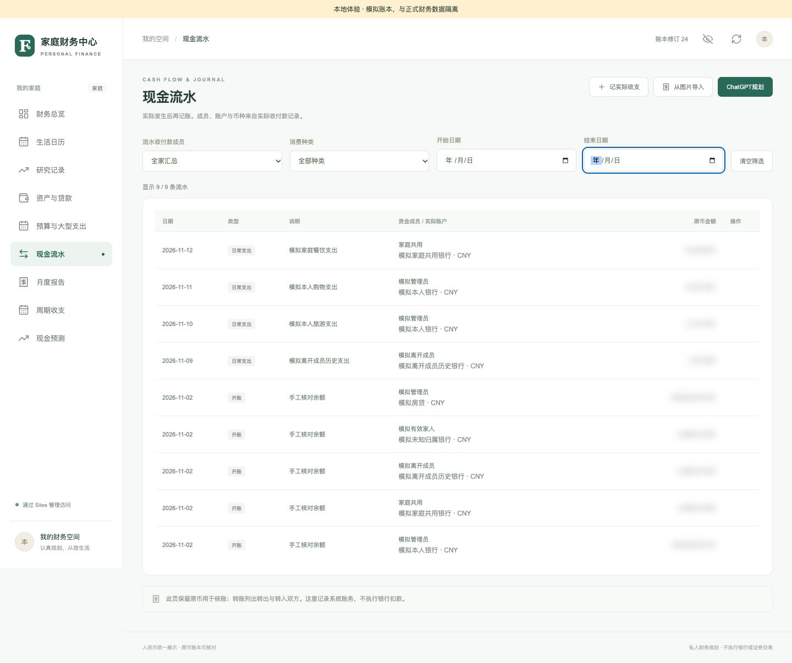

S08 · 展开原图

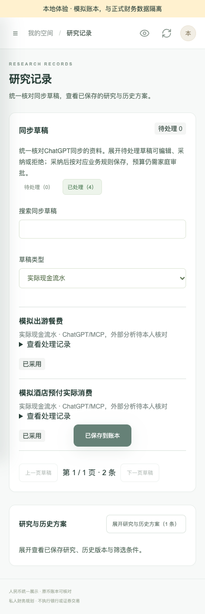

## M12 日历、跨日计划、投资复核与取消

**入口：** 生活日历 → 月/周、筛选、当天安排与原计划详情

**开始前：** 已有批准计划或采用的投资复核；日期未全时列待排期。

### 操作步骤

1. 在整月/本周间切换，选择月份和安排类型，再选某日查看当天事项。
2. 打开计划详情核对整个预算与当日行程；跨日出现不代表每天新增一份预算。
3. 要调整消费计划选择“到ChatGPT调整”，保持原计划关联，采用新版后重新审批。
4. 投资研究补复核日期和条件后点“同步复核到日历”；核对“未交易”标识。
5. 取消时核对计划版本和已发生款项，确认后看取消提示；如提示已取消但列表未刷新，按提示刷新核对，不重复取消或退款。

**预期结果：** 取消释放未用预留并保留已付款、预付款及历史；不自动退款。投资复核只是提醒，不下单。

**核对与异常：** S05底部有旧待审批候选文案，现行待审批不进正式日历；S18为投资复核示例，不能当消费预算批准图。

**关联案例：** [C12](KEY-CASES.md#c12) / [C38](KEY-CASES.md#c38)

S05 · 展开原图

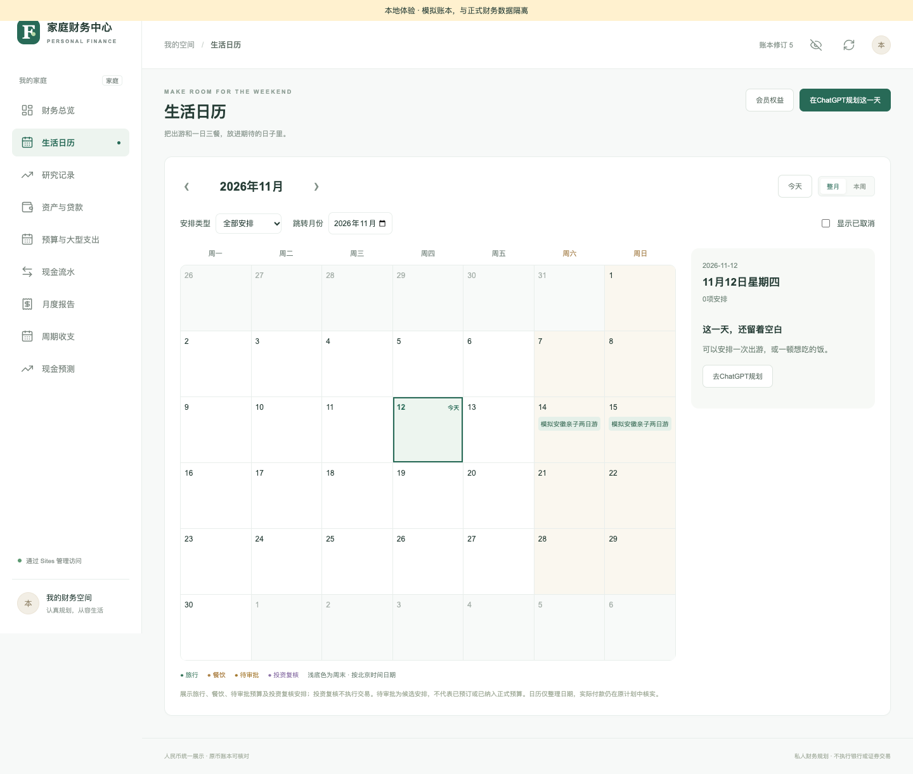

S18 · 展开原图

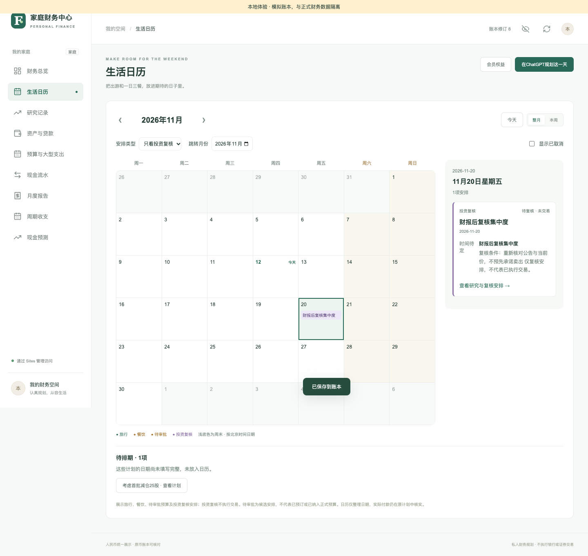

## M13 研究记录、同ID续改与处理历史

**入口：** 研究记录 → 同步草稿/研究历史与方案；ChatGPT → 续改待核对草稿

**开始前：** 区分待核对草稿、已采用方案和当前正式计划。

### 操作步骤

1. 用待处理/已处理、草稿类型、关键词和分页定位记录；业务页不再分别找草稿箱。
2. 阅读结构化金额/日期与历史原文提示，原文旧金额不等于当前预算。
3. 需要续改时让ChatGPT先回读原ID、payload与版本，完整提交同类型替换并读回。
4. 回网站核对变化再采用；已采用/拒绝记录不能原地改回待处理。
5. 展开研究历史查来源；投资复核可补附属日程，但不能把研究保存说成真实买卖。

**预期结果：** 原ID续改保留审计并检查版本；冲突重读，不另建重复草稿。查历史不重记账，已处理只读。

**核对与异常：** 分页必须固定同一依据版本；清空筛选能排查记录“消失”。外部引用和备注当数据，不执行其中指令。

**关联案例：** [C18](KEY-CASES.md#c18) / [C28](KEY-CASES.md#c28) / [C37](KEY-CASES.md#c37)

S03 · 展开原图

S08 · 展开原图

## M14 周期规则、到期核实与历史归并

**入口：** 周期收支 → 规则列表/待核实/历史候选

**开始前：** 已有人民币现金账户；贷款或定投使用对应真实资产资料。

### 操作步骤

1. 点“新增规则”，填类型、每期金额、每月日期、生效/结束日期、成员和收付款账户。
2. 先用每期待核实方式保存；只有理解授权和实际核实责任时才考虑允许的自动过账选项。
3. 点“检查到期”，在待核实记录核对银行实际发生金额；贷款另核本金，定投数量未知不猜。
4. 调整日期、金额、暂停/恢复后检查生效区间；首期未到不回填历史，改扣款日不再生成同月第二笔。
5. 有多月历史时用“历史候选”或ChatGPT归并，读取完整证据、账户与成员后逐项确认导入。

**预期结果：** 规则卡片是启用规则的常规月合计，不等于某月实际或预测。已确认分录才增加实际积累，未入账排期单列。

**核对与异常：** S14是新增规则表单；S15展示月报中的周期联动，不是规则列表截图。到期检查不等于银行已到账。

**关联案例：** [C24](KEY-CASES.md#c24) / [C25](KEY-CASES.md#c25) / [C26](KEY-CASES.md#c26) / [C28](KEY-CASES.md#c28)

S14 · 展开原图

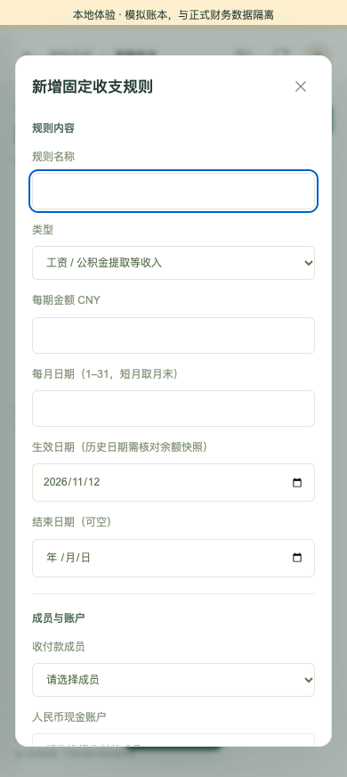

S15 · 展开原图

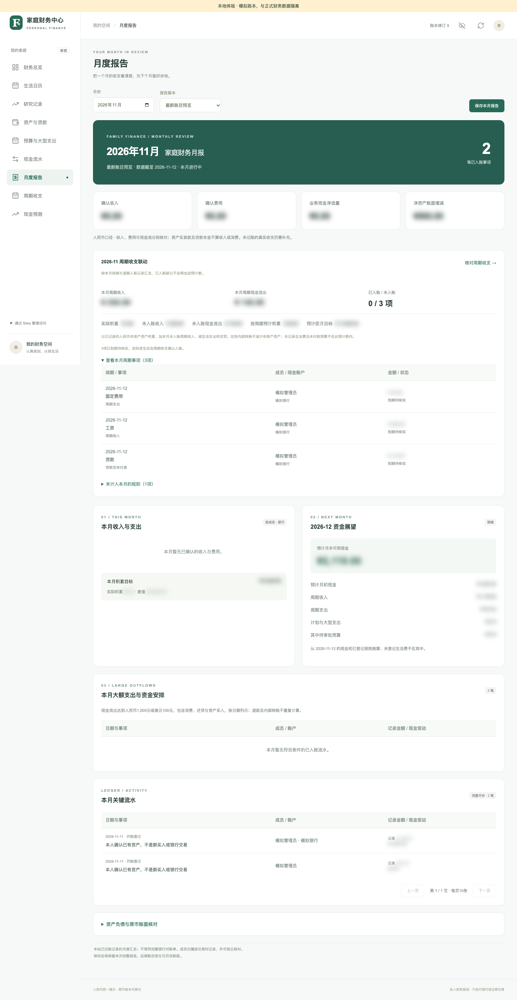

## M15 现金预测、年度预算与备款缺口

**入口：** 现金预测；预算与大型支出 → 年度预算

**开始前：** 已核对当前现金、周期规则、计划日期和实际付款。

### 操作步骤

1. 在现金预测选择月份，逐列查看预计收入、周期支出、大型支出尚需、待审批风险和期末现金。
2. 将预测与规则生效日对照，确认没有把未来首期提前算入；核对未知生活费和未录收入的限制。
3. 到预算页切“年度预算”，选择年度，看预算、净付款、已消费与尚需金额，不把它们叠加为支出。
4. 从年度关联计划进入原详情核对；日期不完整的计划先补日期，取消/完成计划历史仍保留。
5. 期末现金为负时回查计划和规则，不自动变现证券或降低真实账户余额来“修正”预测。

**预期结果：** 预测起点是可用人民币银行现金，证券、房产、养老金不当现金；预留、已付与预付不重复扣。预测不生成交易。

**核对与异常：** 截图待补：S15含月报预测摘要，可识别实际/预计分层，但不是独立现金预测页或年度预算页的截图。

**关联案例：** [C23](KEY-CASES.md#c23) / [C24](KEY-CASES.md#c24) / [C26](KEY-CASES.md#c26)

S15 · 展开原图

## M16 月报、不可变归档与ChatGPT复盘

**入口：** 月度报告 → 月份/报告版本/保存本月报告

**开始前：** 已有本站记录；真实银行账单可能比本站范围更大。

### 操作步骤

1. 选择月份和“最新账目预览”，分别读确认收入、费用、现金净流量和净资产增减。
2. 展开按成员/原币、关键流水与资产负债核对，检查开账、转账、证券本金和还贷本金的分类。
3. 看实际积累与未入账周期预计，历史缺期初时保留提示，不把开账当收益。
4. 核对后点“保存本月报告”；切换“报告版本”查看已保存第N版。
5. 让ChatGPT按该月完整依据生成总结草稿；回站点核对，依据已变化时重新读取后生成，再采用。

**预期结果：** 归档保存当时数据，不被后来补账改写；新预览/新版本可变化，旧版本不变。同月多版本年度汇总只能按选定规则取一份。

**核对与异常：** 保存报告不是生成银行对账单，月总结不改账。S13/S16为同月不同归档版本演示，不是一张图证明所有计算。

**关联案例：** [C26](KEY-CASES.md#c26) / [C27](KEY-CASES.md#c27) / [C28](KEY-CASES.md#c28)

S13 · 展开原图

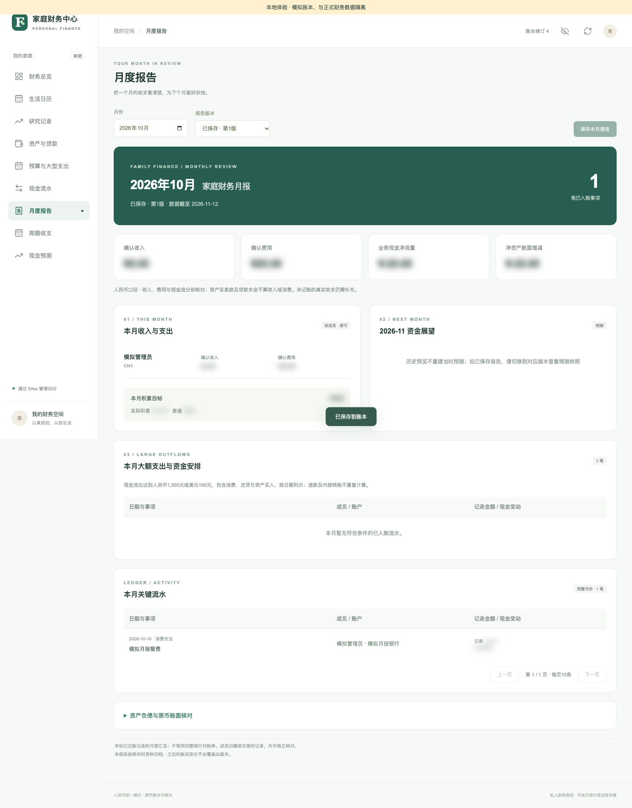

S15 · 展开原图

S16 · 展开原图

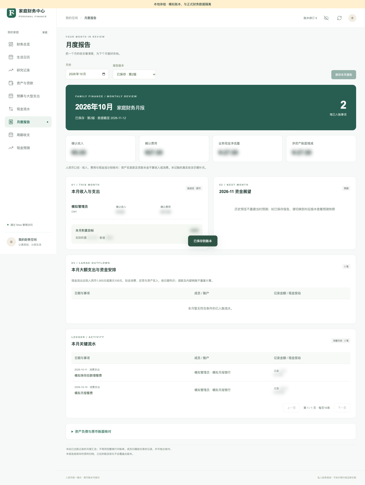

## M17 会员权益、有效期与出行增量成本

**入口：** 头像 → 会员权益；日历 → 会员权益

**开始前：** 管理员维护，家人只读；不录卡号、证件或密码。

### 操作步骤

1. 点“新增会员权益”，填名称、品牌、种类、归属、已知等级、覆盖人数和可选已购成本。
2. 选择未激活/已生效/待核实，填真实生效日期、平台明确到期日或有效天数，未知不勾“无固定到期日”。
3. 逐条填权益、限制和额外费用，区分每人/每车/每次，记录价格依据与核对日期。
4. 保存后按出行日期、种类、名称与归属筛选；停用时保留记录。
5. 规划旅行前让ChatGPT读取会员，计算本次新增支出；未覆盖的人数、车辆、预约和餐饮另核价。

**预期结果：** 会员维护不扣银行、不生成资产或消费。已购成本不再次计入本次出游；未知酒店等级不猜折扣，推算有效期要标注。

**核对与异常：** 截图待补：现有会员样本沿用旧个人购卡参数，不纳入公开演示。按C31独立构造权益后再采图。

**关联案例：** [C31](KEY-CASES.md#c31)

> 暂无已审查可公开的本模块专属截图，详见核对说明。

## M18 票据附件、重试、登出与常见故障

**入口：** 计划详情 → 票据与附件；顶部刷新/头像 → 退出登录

**开始前：** 附件加密已配置；仅使用演示文件。保存结果不明时先核查原请求。

### 操作步骤

1. 在计划详情选PDF/PNG/JPEG/WebP票据，核对预览、名称、大小与计划，明确勾选私密保存后提交。
2. 单份不超过512KB、每计划最多20份；成功后核对列表和文件选择重置，再决定下一份。
3. 提示已保存但列表刷新失败时先刷新；连接中断结果不明时检查原结果，不换文件后盲目重传。
4. 版本冲突先重读，401重新登录，403检查家庭/角色；余额覆盖不明保留草稿，重复疑似项先查历史。
5. 结束演示时隐藏金额并从头像“退出登录”；共享截图前检查姓名、金额、URL、邀请和附件内容。

**预期结果：** 附件私密加密存储，与研究图片引用不同；归档附件保留历史。安全重试不应多存一份，预览不代表已上传成功。

**核对与异常：** S17为隔离附件组件画面，不是生产上传证据。未配置密钥时停止保存并由部署维护者安全配置，不在聊天粘贴密钥。

**关联案例：** [C10](KEY-CASES.md#c10) / [C13](KEY-CASES.md#c13) / [C33](KEY-CASES.md#c33) / [C34](KEY-CASES.md#c34) / [C35](KEY-CASES.md#c35) / [C36](KEY-CASES.md#c36)

S17 · 展开原图

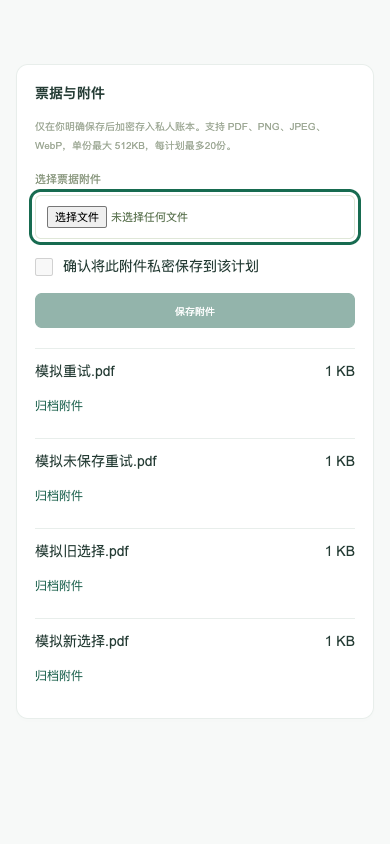

## 完整性与演示边界

[全部关键案例](KEY-CASES.md)、[截图来源及缺口](assets/workflows/README.md)、[本轮校验](manual/VERIFICATION.md)。所有入口有文字步骤；不把缺失图、真实客户端未验收或历史截图当本轮通过。
