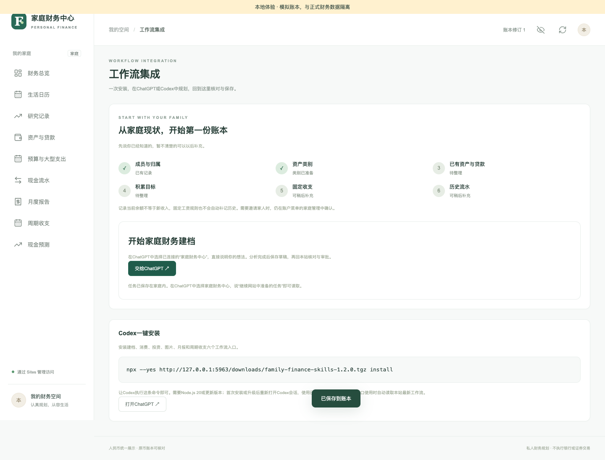
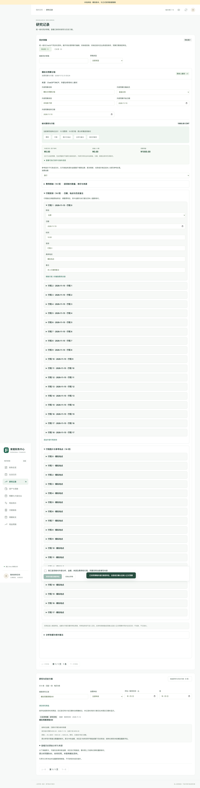
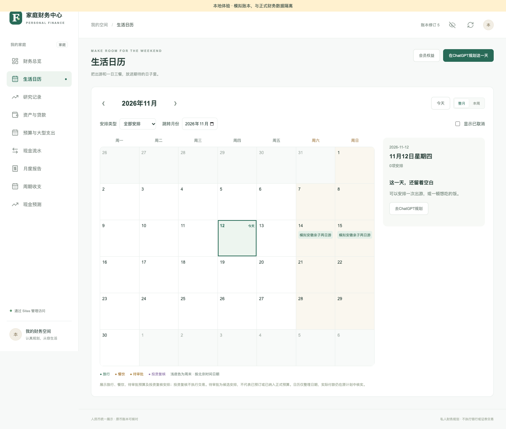
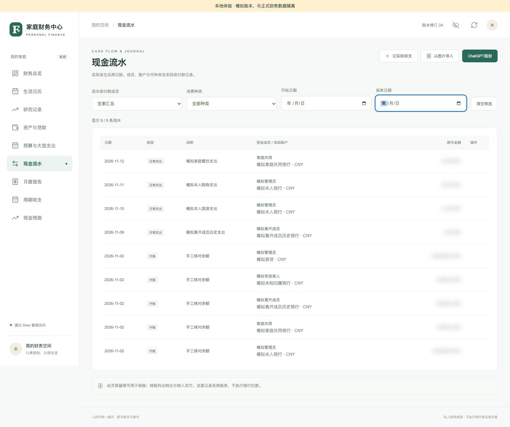

# User guide and workflow screenshots

[中文](USER-GUIDE.md) · **English** · [Documentation](README.en.md)

Images are **existing local-browser screenshots from 2026-11-12**, using isolated ledgers, simulated identities, and explicitly supplied draft content. They come from separate scenarios, not one continuous production session. They do not verify real ChatGPT inference, hosted sign-in, or bank transactions. Images were inspected and copied unchanged, not generated or redrawn. See [provenance and limitations](assets/workflows/README.md).

## 1. Sign in, join a household, and start onboarding

Open your own site and sign in with ChatGPT. To join an existing household, follow an administrator's invitation and confirm on the website. A bookkeeping nickname does not grant sign-in access.

An empty household starts from **开始家庭财务建档 / Start household onboarding** on the overview. Existing households continue through **账户菜单 → 工作流集成 / Account menu → Workflow integration**. Add members, categories, existing balances and their dates, goals, and recurring items. Unknown details can wait. Opening an existing asset is not new income and does not debit a bank account again.

## 2. Organize information in ChatGPT and save a draft

Select your connected Family Finance Center and ask it to read existing data and guide onboarding, or describe a spending, investment, or image task. Workflows read their latest instructions and household context, then submit and read back drafts when you ask to save.

After selecting **交给ChatGPT / Continue in ChatGPT** on the website, tell the connected chat to continue the prepared task. Private details stay within the household, not in external URLs. For Codex, copy the current installation command from your own integration page; do not run the local URL or old version shown in S02. On phones and iPads, use the connected ChatGPT conversation rather than desktop PowerShell commands.

S02: Workflow entry and task handoff

The current seven entry points cover onboarding, spending, investment, images, monthly review, recurring analysis, and approval queries. Installing entry files does not grant MCP authentication or household access. Sharing GitHub source does not install a plugin; unpublished plugin capabilities are not current features.

## 3. Review drafts under Research records

All drafts appear under **研究记录 / Research records**, with pending/processed tabs, type filters, search, and pagination. Check members, actual accounts, currency, amounts, dates, and sources. Edits reset confirmation. Reject unwanted drafts while preserving history.

For budgets, also review quantities, unit prices, itineraries, and price conditions. Keep estimates, quotes, calculations, reserves, and unknown values separate. Unknown does not mean free.

S03: Budget draft, costs, and itinerary — full screenshot

| Draft | Result after review and adoption |
| --- | --- |
| `budget` | Starts household approval; no cash debit |
| `cashflow` | Records a confirmed actual event after checking balance coverage; may link a plan or settle a prepayment |
| `asset` | Opens an existing holding after confirmation; not a new purchase |
| `investment` | Saves research and optional follow-ups; no trading |
| `monthly_review` | Saves a summary after validating the report basis; no accounting changes |
| `recurring` | Saves a rule for verification after checking transaction evidence; automatic posting off by default |
| `setup` | Saves profiles, categories, goals, or recurring configuration; no sign-in permissions |

Amount inputs use decimal strings in major currency units, such as yuan or dollars. Read fields ending in `Minor` as minor units, such as fen or cents. Do not add account summaries to their underlying holdings again.

## 4. Approve together, then view the calendar

Choose **采用并提交家庭审批 / Adopt and submit for household approval**, then open the plan under **预算与大型支出 / Budgets and major expenses**. Each member signs in, reviews, and submits their own opinion. An approval link grants neither access nor consent.

After all active signed-in members agree, the plan enters the formal budget and calendar. Changes to amounts, dates, costs, or ownership restart approval. Consent to an older version does not approve a newer one. Approval and scheduling do not debit cash.

[S04: Sharing household approval on mobile](assets/workflows/04-share-approval.png) shows the signed-in review entry; it is not proof of completed approval.

S05's older footer mentions pending candidates. Follow the current rule above: pending budgets do not enter the formal calendar. The image identifies where an approved plan appears.

## 5. Record expenses after they occur

Record actual expenses from plan details, or have ChatGPT submit a cashflow draft linked to its original `planId`, then review it on the website. Supply the actual amount, date, paying member, and account. Confirm whether the current balance already includes the event. Future and unperformed events are not actual expenses.

For history already included in a balance, match the snapshot date to avoid a second debit. Prepayment consumption references its original prepayment and reduces the prepaid asset only. Review refunds against their original payment. Use dedicated website flows for loan repayments, securities, and transfers.

S06: Actual-cashflow review form on mobile

After adoption, inspect the cashflow record and account balance. Processed drafts are read-only; repeated adoption must not post twice.

[S08: Processed actual-cashflow drafts on mobile](assets/workflows/08-adopted-mobile.png) shows processing status only, not independent evidence of balance accuracy or idempotency.

## 6. Investment, recurring items, and monthly reports

Investment research preserves conclusions and sources; follow-ups are marked as unexecuted trades. Recurring analysis reads complete paginated history and saves rules after confirmation without inventing past income. Monthly reports separate actual and forecast values. Loan principal, opening balances, and internal transfers are not income or returns. Historical archives retain their original version.

| Situation | Action |
| --- | --- |
| Missing draft | Confirm the household, read the draft back, clear filters, refresh |
| Conflict or uncertain save | Read ledger and original draft status before creating anything again |
| Read-only access | Check the role; members may submit their own budget opinions, not general financial changes |
| Installer returns 401 | Follow your own signed-in site's instructions; never publish credentials or private links |
| Older model instructions | Follow current workflows; retired model, search, and vision keys are no longer required |

See [data security](../SECURITY.en.md). Real-client acceptance is separate; follow the [Chinese new-chat checklist](CHATGPT-NEW-CHAT-TEST.md).
