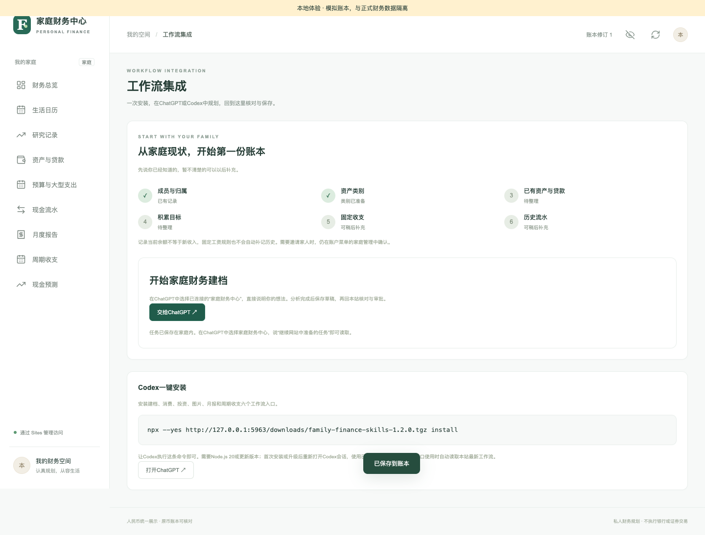
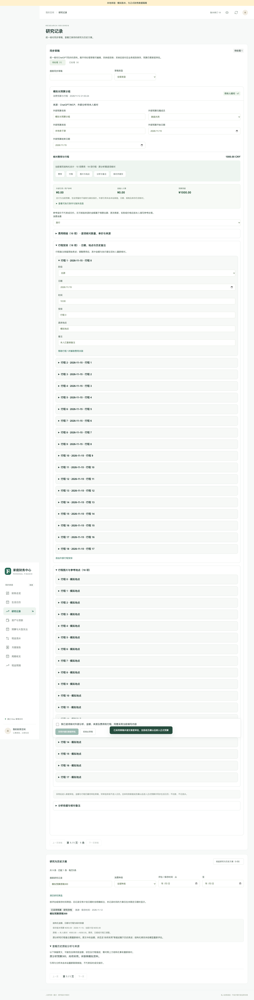
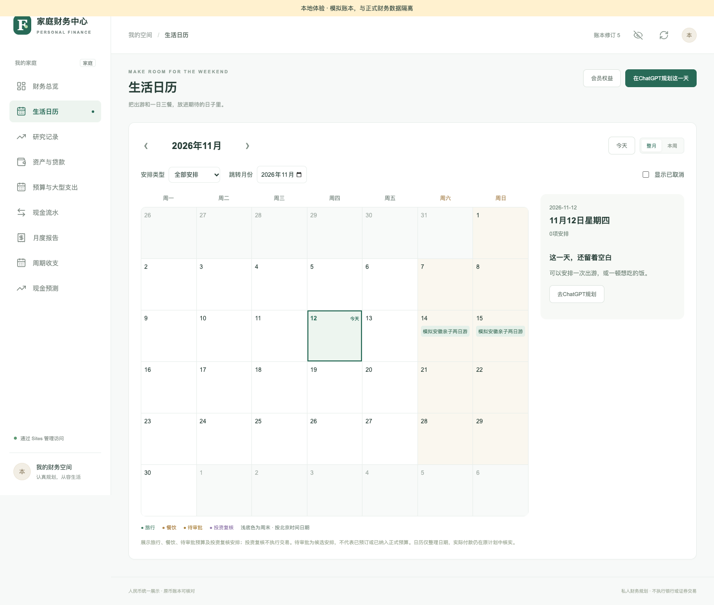
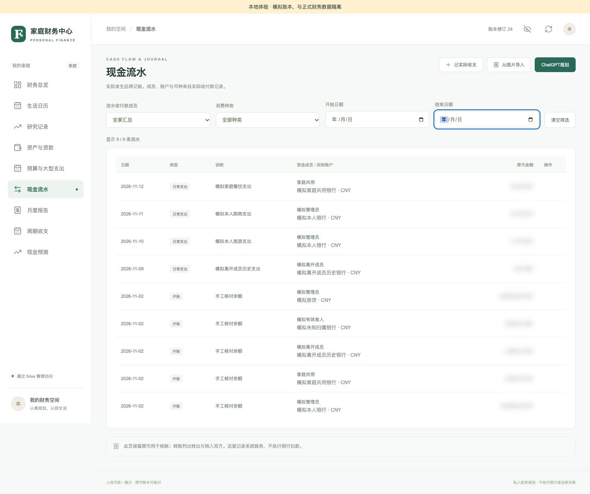

# 使用指南与流程截图

**中文** · [English](USER-GUIDE.en.md) · [文档导航](README.md)

图片为 **2026-11-12 已有本地浏览器截图**：隔离账本、模拟身份、明确提供的结构化草稿。它们来自不同用例，不是一组连续生产操作，不证明真实 ChatGPT 推理、托管登录或银行交易通过。本轮逐张检查后原样收录，未生成或改画界面；详见[来源与适用范围](assets/workflows/README.md)。

## 1. 登录、加入家庭与建档

打开自己的站点并用 ChatGPT 账号登录。加入家人已有家庭时，使用管理员的邀请链接并在网站确认；记账昵称不会自动取得登录权限。

空家庭从总览“开始家庭财务建档”进入，已有家庭从账户菜单“工作流集成”继续。逐步补充成员、类别、已有余额及日期、目标和固定收支，未知项可先跳过。已有资产开账不当新收入，也不重复扣银行现金。

## 2. 在 ChatGPT 整理并保存草稿

选择已连接的“家庭财务中心”，说明“先读取已有数据，按步骤帮我建档”，或提出消费、投资、图片任务。工作流先读取最新正文和家庭依据；需要保存时提交草稿，并回读确认结果。

从网站点“交给ChatGPT”后，在已连接会话说“继续网站中准备的任务”。私人任务保存在家庭内，不拼入外链。Codex 安装从自己站点“工作流集成”复制当前命令；不要执行截图中的本机地址和旧版本命令。手机或 iPad 使用已连接的 ChatGPT 会话，无须执行桌面 PowerShell 命令。

S02：工作流入口与任务接续截图

当前七入口为建档、消费、投资、图片、月度总结、周期归并和审批查询。入口安装不会自动授予 MCP 或家庭权限。GitHub 分享不等于安装插件；未发布的插件能力不作为现有功能。

## 3. 在研究记录逐项核对

全部同步草稿集中在“研究记录”，支持待处理/已处理、类型、搜索和分页。展开后核对成员、账户、币种、金额、日期和来源。修改后重新勾选确认；不采用时拒绝并保留历史。

预算另核费用数量、单价、行程和报价条件。估算、引用报价、按输入计算、预留、未知分别看待，未知不能填零元冒充免费。

S03：预算草稿、费用与行程核对长图

| 草稿 | 核对采用后的结果 |
| --- | --- |
| `budget` 消费预算 | 发起家庭审批，不扣现金 |
| `cashflow` 实际流水 | 确认已发生及余额覆盖后记账；可关联预算或冲抵预付款 |
| `asset` 已有资产 | 确认持有后开账，不代表新买入 |
| `investment` 投资研究 | 保存研究和可选复核安排，不交易 |
| `monthly_review` 月总结 | 校验月报依据后保存总结，不改账 |
| `recurring` 周期规则 | 核对流水依据后保存待核实规则，默认不自动过账 |
| `setup` 建档配置 | 保存成员档案、类别、目标或固定规则，不授予登录权限 |

金额输入依接口约定使用元/美元十进制字符串；读取中的 `Minor` 为分/美分。账户汇总与底层持仓不能再加一次。

## 4. 家庭审批后进入日历

选择“采用并提交家庭审批”，在“预算与大型支出”打开详情。每位家人分别登录，查看方案并提交本人意见。分享审批链接不自动授权，也不代表同意。

全体有效登录成员同意后，正式计划进入预算和生活日历。金额、日期、费用或归属变更须重新审批；旧版同意不等于新版通过。审批及排期不扣款。

[S04：手机分享家庭审批截图](assets/workflows/04-share-approval.png)展示登录后核对的链接入口；它本身不是审批完成证据。

S05 底部旧文案提及待审批候选。现行规则以本节为准：待批预算不进入正式日历；图片用于识别已批准计划的日历位置。

## 5. 实际发生后再记账

在计划详情记录实际消费，或让 ChatGPT 提交关联原 `planId` 的实际流水草稿，再回研究记录核对。填写实际金额、日期、付款成员和账户，明确当前余额是否已包含该笔。未来或未发生的事项不能记实际消费。

历史已含在余额中时，匹配余额快照日期，避免二次扣款。预付款消费关联原预付款，只减少预付资产，不再扣银行；退款从原付款核对。贷款还款、证券成交和转账使用网站专用入口。

S06：手机实际流水核对表单

采用后到现金流水查记录，到资产页核对账户余额。已处理草稿只读，重复采用不应再次记账。

[S08：手机查看已采用实际流水草稿](assets/workflows/08-adopted-mobile.png)只展示处理状态，不独立证明余额计算或幂等正确。

## 6. 投资、周期与月报

投资研究保存结论和来源，复核标明“未交易”。周期归并读取完整分页流水，确认后保存规则，不追补过去未记录收入。月报区分实际与预计，贷款本金、开账和内部转账不算收入或收益；历史归档保留原版本。

| 遇到的问题 | 处理 |
| --- | --- |
| 草稿未出现 | 确认同一家庭，回读草稿，清除筛选并刷新 |
| 版本冲突、保存结果不明 | 重读账本与原稿状态，勿直接重复新增 |
| 只有查看权限 | 核对角色；普通成员可提交本人预算意见，不能一般财务写入 |
| 安装包401 | 从自己已登录站点按页面指引操作，不公开凭据或私人链接 |
| 看到旧模型配置说明 | 使用当前工作流；不再需要旧站内模型、搜索、视觉 Key |

权限与发布规则见[数据安全](../SECURITY.md)。真实客户端另按[新会话检查](CHATGPT-NEW-CHAT-TEST.md)验收。
